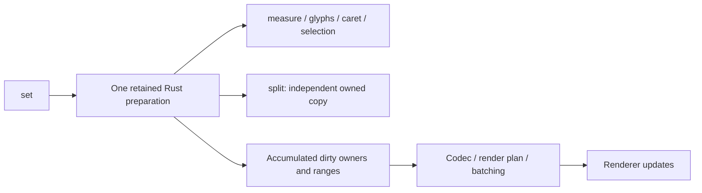

# Prepared paragraph reads and renderer publication

The accepted design has two stages and one layout implementation. A bound setter validates and encodes authored
input, prepares invalid layout stages in Rust, and adopts the prepared revision synchronously. Reads answer from that
revision before any render publication. Preparing one label does not publish or relayout unrelated labels.

| Call                        | Required work                                                                            | Work excluded                                            |
| --------------------------- | ---------------------------------------------------------------------------------------- | -------------------------------------------------------- |
| `set()`                     | Detect change, prepare invalid Unicode/shaping/layout stages, record dirty owners/ranges | Renderer gather, batch realization, GPU submission       |
| `measure()`                 | Read cached summary                                                                      | Repeat preparation or publication                        |
| Glyph/caret/selection query | Materialize requested inspection from prepared layout                                    | Repeat input encoding/shaping or source publication      |
| `split()`                   | Copy selected prepared records and retain independent resources                          | Publish source/root or redo layout                       |
| Publication                 | Gather changed renderer records, update necessary topology/bindings, encode patches      | Rediscover mutations or prepare unchanged semantic state |

Prepared layout revision and renderer publication generation are separate. Read caching must account for lifetime and
identity changes, including sibling creation/removal, while copies remain independent of later source edits/disposal.
Renderer-owned in-flight storage stays immutable; borrowed query views have explicit lifetimes. Empty roots retain
adapters until teardown. Topology changes and dense updates may broaden renderer work through the same executor.

The former design in this file used a cross-call speculative query transaction, invalidation on mismatched publication,
and A/B compute state as rollback protection. Those are superseded by the accepted decision. Reusable prior-input
scratch is permitted; committed-state undo and hidden retry are not. Main's query-first behavior is the correctness
control; the held refactor adds durable setter preparation and incremental publication. No public API change.

Acceptance and evidence live in the compact tracker; this document does not claim those gates are already passed.
