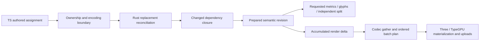
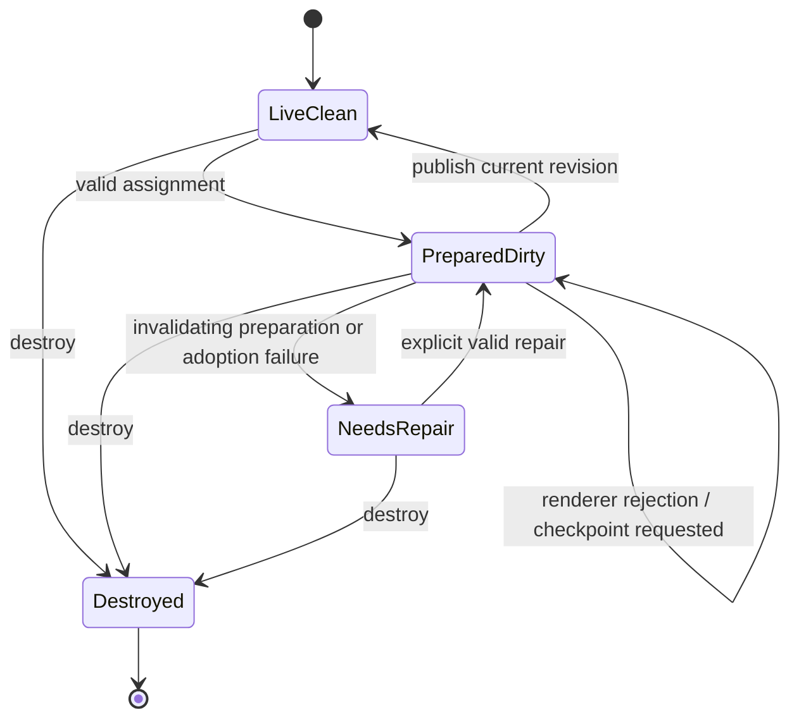

# Principled classification of retained text performance

## Decision boundary

The user deleted the implementation goal. Runtime, configuration and test edits are frozen. This is a proposal for review, not authorization to implement. Existing changes are preserved, ropes remain held, and no merge or release is authorized. This report supersedes the frontier checklist's active implementation instructions; it does not silently replace accepted API or lifetime decisions.

The principal error in the previous approach was treating local improvements as an architecture plan. The right unit of analysis is a transformation with explicit inputs, dependencies, retained output, invalidation rule and measurable cost. A faster leaf kernel cannot repair unnecessarily invalidating the whole output.

## What the evidence establishes

Reviewed source: `.cache/publication-range-spike`, branch `feat/rust-text-input-wire`, HEAD `722a2bdd` plus preserved uncommitted changes. Frozen candidate package SHA-256 `346eda0c095028527cd811029c0b9e5cd879ed64c43347fa4fa17462d6666b86`; baseline is pinned main `2f62d6b`, package `c2ea9cef…`. These are not a current-head versus 0.1.0 release comparison.

The completed four-block full run reports 76 faster / 16 slower / 33 neutral, four clock-confounded exclusions, and workload median p50 2.200 → 2.040 ms. Correctness checks reported no failures. Baseline/candidate clock drift was 7.7%/10.3%. A 9.07-second archive-reading operation interfered with baseline batching. Consequently these results locate suspicious workloads; they do not clear acceptance or establish reliable causal magnitudes. Artifact input hashes remained unchanged.

Receipts: `.cache/retained-prepare-publish-wave1/full-346-main/labs/{summary.md,comparison.txt,manifest.json}`, `input-hash-closure.json`, `timing-interference.json`.

| Diagnostic slowdown                      |     Main | Candidate | Absolute increase |
| ---------------------------------------- | -------: | --------: | ----------------: |
| Long paragraph: one character + measure  |  1.02 ms |   3.67 ms |           2.65 ms |
| Publish 1,024 retained Text objects      | 20.47 ms |  26.09 ms |           5.62 ms |
| Rewrite 512 labels                       | 10.84 ms |  13.22 ms |           2.38 ms |
| Inspection + publication after width     |  9.96 ms |  12.07 ms |           2.11 ms |
| Glyph inspection after width             |  9.91 ms |  11.58 ms |           1.67 ms |
| Mount 100 labels + borrow once           | 14.39 ms |  16.08 ms |           1.69 ms |
| Mount/publish 22k-glyph paragraph        | 23.62 ms |  25.10 ms |           1.48 ms |
| Long Fredoka paragraph edit + measure    |  2.28 ms |   2.97 ms |           0.69 ms |
| Measure after text change                |  1.76 ms |   2.37 ms |           0.61 ms |
| Long unsafe-boundary reflow              | 0.750 ms |   1.16 ms |          0.410 ms |
| Rewrite 256 labels                       |  5.76 ms |   6.61 ms |           0.85 ms |
| Rewrite 64 labels                        |  1.94 ms |   2.11 ms |           0.17 ms |
| Long reporter workaround reflow          | 0.872 ms |   1.07 ms |          0.198 ms |
| Copy metrics, 100 unchanged labels       | 0.176 ms |  0.229 ms |          0.053 ms |
| Measure 1,000 unchanged labels           | 0.258 ms |  0.285 ms |          0.027 ms |
| First same-length publication, 10 labels | 0.443 ms |  0.468 ms |          0.025 ms |

The last three micro-optimizations did not resolve unchanged assignment overhead: the latest focused comparison still showed roughly 0.26–0.41 ms increases in unchanged cases. Stop tuning those branches without exclusive-stage evidence.

Current shaper is 1,622,359 raw / 599,655 gzip bytes versus main 1,456,090 / 534,013: +166,269 / +65,642 bytes. This is an unresolved architecture cost. Earlier 1,042-test clearance belongs to an earlier source checkpoint; latest narrow checks do not confer full current-source clearance. Current candidate visual acceptance and complete public declaration comparison are outstanding.

## Cost model and lower bounds

Let n be authored text length, s span/style fields, N retained owners, k dirty owners, U Unicode units analyzed, H units shaped, L lines recomposed, B clusters/break opportunities examined, M bytes moved in retained storage, P upload bytes and C engine calls.

Exclusive CPU cost can be modeled as ingress(n,s) + reconciliation(n) + analysis(U) + shaping(H) + flow(L,B) + publication(M,P) + dispatch(C). This is a measurement decomposition, not a fitted timing equation. GPU execution and asynchronous queueing require a separate critical-path model; CPU benchmarks are not FPS. Compare absolute p50/p95 latency and variance for each operation, never average percentage wins across unlike workloads.

A fresh full replacement has worst-case Ω(n) information cost to discover an arbitrary change. A fresh mutable span graph requires inspecting relevant fields; freezing its outer array does not prove its contents. These lower bounds do **not** require rebuilding unchanged derived layout or walking N unrelated owners. A package-owned immutable snapshot with trustworthy identity can avoid rediscovery. Dense k=N workloads legitimately perform broad work.

## Classification and candidate solutions

| Problem class                             | Current mechanism / evidence                                                                                                     | Appropriate solution family                                                                   | Proof and measurement required                                                                            |
| ----------------------------------------- | -------------------------------------------------------------------------------------------------------------------------------- | --------------------------------------------------------------------------------------------- | --------------------------------------------------------------------------------------------------------- |
| Trust boundary and graph canonicalization | Shared span owner; caller validation, binding projection, ownership proof                                                        | Validate mutable author data once; preserve immutable provenance downstream                   | Getter/error order, inherited style fields, aliases, disposal; bytes/fields read and allocations versus s |
| Sequence reconciliation                   | Rust u32 SWAR compares two UTF-16 units; equal-length sparse changes; length changes use common prefix/suffix and one envelope   | Packed comparison; bounded anchoring only if interior islands matter                          | Scalar seams, repeated text, adversarial ambiguity; scan cost and resulting dirty coverage                |
| Incremental dependency evaluation         | Paragraph preparation chains Unicode, styles, bidi, shaping, geometry, positioning                                               | Dependency graph, sound invalidation, convergence and reusable summaries                      | Full recomputation oracle; U/H/L and invalidation reasons                                                 |
| Unicode boundary analysis                 | UTF-8 and flat derived arrays rebuilt outside limited same-length ASCII-letter reuse                                             | Associative summaries where valid; stateful derived break structures with forward repair      | Pinned Unicode conformance, RI parity, combining sequences, bidi context, propagation distance            |
| Shaping reuse                             | Contextual runs and safe boundaries constrain reuse                                                                              | Cached dependency regions plus bounded re-shaping; whole-run fallback when context demands it | Font/script/features/direction and unsafe-boundary evidence, not string equality alone                    |
| Wrapping and flow                         | Existing cursor/correction/metric/drop-cap convergence and suffix splicing; width changes can still move following lines/columns | Restart before affected boundary; stop only on equal continuation state                       | Matching break plus matching dependencies; width/font/flow changes may invalidate broadly                 |
| Logical order versus physical storage     | Dirty owner order already indexed; packed gathered lanes still move clean data                                                   | Preserve explicit deltas; stable segments/slots if packed movement dominates                  | Identity/order mapping, clean-gap/suffix bytes, growth/shrink workloads                                   |
| Batch topology and renderer planning      | Complete-topology path revisits records after prefix                                                                             | Incremental batch metadata and sparse materialization; dense fallback in same executor        | Transparent order, binding keys, direct/indexed draw parity, visited records                              |
| Sparse inspection and independent copying | `copy_glyphs` scans positioned glyphs and searches selection IDs                                                                 | Revision-aware identity lookup and selective materialization if scan dominates                | Selection ordering, blank filtering, generations; inspected versus copied glyph counts                    |
| FFI/control-plane granularity             | Synchronous per-set preparation imposes k calls                                                                                  | Minimize per-call fixed work; explicit bulk contract only if justified                        | Same-frame query semantics; crossings and encode/call overhead on small labels                            |
| Upload scheduling                         | Patches versus full uploads trade command cost for bytes                                                                         | Dirty buckets/range coalescing with measured dense threshold                                  | Driver/backend measurements, upload bytes, draw count; do not infer GPU speed from CPU timing             |
| Memory and code size                      | Arc chunk sharing, flat arrays and staged state coexist                                                                          | Reuse capacity, remove duplicate ownership, bounded compaction only if needed                 | Allocated/copied/live bytes; fragmentation; Wasm attribution and deleted old paths                        |

These are distinct optimization targets that share a delta contract. They should not become separate competing executors.

## Rope Science: what applies, what exists, what is missing

[Part 1](https://xi-editor.io/docs/rope_science_01.html) explains associative summaries: recompute affected leaves and ancestors rather than reduce the entire sequence. The current record rope has 32-record Arc leaves and summaries for record count, fragment count and source coverage. That supports structural sharing and navigation. It does not itself summarize grapheme state, bidi dependencies, line-breaking context or all renderer bytes.

[Part 2](https://xi-editor.io/docs/rope_science_02.html) distinguishes additive metrics from stateful boundaries and discusses aligned secondary break structures. [Part 3](https://xi-editor.io/docs/rope_science_03.html) gives regional-indicator parity as a compact summary for otherwise nonlocal context. Thus Unicode is part of the theory, not an unrelated exception. However a valid summary must encode the state required by our pinned Unicode rules, including script neutral-resolution context and downstream bidi dependencies; an old article is not the current conformance oracle.

[Part 4](https://xi-editor.io/docs/rope_science_04.html) demonstrates richer ordered summaries. Associativity must be established for the specific operation; it does not prove arbitrary shaping is local.

[Part 5](https://xi-editor.io/docs/rope_science_05.html) uses incremental word-wrap repair and convergence; it explicitly discusses rejecting a monoid construction for engineering fit. The useful invariant is reuse once the continuation is equivalent, not merely once an offset matches. [Part 6](https://xi-editor.io/docs/rope_science_06.html) separates cold/broad work from incremental repair and discusses parallel wrapping. We remain synchronous; introducing async is not necessary to use the incremental ideas.

[Part 12](https://xi-editor.io/docs/rope_science_12.html) carries deltas into rendering using cache validity and a lightweight shadow. This is directly relevant: retaining upstream chunks has little benefit if downstream gathering expands the edit into repacking everything. Xi's viewport strategy is not authorization to add offscreen culling here.

Already consolidated: dirty-owner work ordering exists, and flow repair already has convergence with retained suffix splicing. Current preflight builds or reuses the Unicode candidate once; `prepare_unicode` adopts that result into retained preparation. Earlier sampled duplicate preflight/paragraph analysis is historical evidence, not a remaining fix. Do not re-add an analyzer or optimize a retired path.

Observed gaps: text units and stable unit IDs remain flat vectors; Unicode analysis clears/rebuilds flat arrays; gather source records share clean rope ranges but packed glyph/field gaps use `extend_from_within`; topology rebuilding visits glyphs after the retained prefix. Consequently **record ropes are present, but end-to-end minimal invalidation is incomplete**.

SIMD/SWAR reduces the constant factor of necessary leaf scans. It does not remove a suffix copy, restore a lost delta, or prove shaping safety. Choose leaf sizes and SIMD unroll factors by measured cache/binary trade-offs; do not confuse codec register limits, four-lane field alignment and kernel unroll counts.

## Algorithmic proof obligations

A rope summary is an ordered monoid homomorphism: `summary(x ++ y) = combine(summary(x), summary(y))`, with an identity and associative combine. Its benefit depends on bounded summary size and bounded leaf recomputation, not merely on placing records in a tree. Prove it under random chunk boundaries and adversarial text. Checked overflow can make combination partial; tree regrouping must preserve the same overflow policy.

For a stateful boundary pass, a chunk can instead represent a transition `F_chunk: incoming_state → outgoing_state + boundaries`. Transitions compose in order. This is useful only if the relevant state can be represented compactly; a table over an enormous state space is not a practical summary. Reuse of a derived suffix requires unchanged source correspondence, equal incoming analysis state and equal dependency versions. Bidi, neutral-script resolution and font shaping need separate dependency proofs; RI parity alone is insufficient.

For line repair, convergence means the continuation state agrees: source/cluster correspondence, cursor, remaining flow region, correction state, metrics and drop-cap effects. Equal break offsets alone do not imply equal future layout. Track examined clusters/opportunities as well as line count: a single unbroken line can contain most of the paragraph.

For publication, distinguish immutable logical sequence sharing from physical relocation. A packed front insertion has linear suffix movement irrespective of tree lookup cost. Stable physical slots avoid that movement only if the ordered draw representation does not rebuild an equally large index stream. Segmentation must preserve batched rendering and bounded metadata locality. Any amortized compaction claim must specify slack, a potential/budget, maximum per-operation work and the lifetime of old pages; an amortized average alone does not bound frame jitter.

For a selected independent copy, allocation and copying selected output are necessary; searching every source glyph is a separate implementation cost. Current `copy_glyphs` scans positioned glyphs and binary-searches requested IDs. Investigate a generation-aware lookup only if measured cost justifies its retained metadata and lifetime burden.

## Whole-system contract and lifetime review

Every arrow must preserve owner identity, revision, coordinate mapping and dirty scope. A boolean dirty flag alone loses location and causality. Dirty bits classify work; ranges and correspondence describe where to do it. Retain both only where necessary in one data layout.

This is a proposed review abstraction, not a claim that current enums implement it exactly. Current target rejection preserves prepared Rust state and requests a renderer checkpoint on the next explicit publication; reads do not trigger an implicit retry. Invalidating preparation/adoption failures are a distinct repair state. Specify failure disposition before implementation: errors throw at the call site; no stale speculative cache may authorize reuse. An empty publication means no work, not destruction of the publisher lease. Sibling lifecycle changes must invalidate generation-sensitive identities without silently invalidating an independent split copy.

Semantic revision and published revision can differ. Queries must describe the requested prepared revision; independent copies own their storage/bindings. Renderer-visible bytes must remain valid until the renderer has consumed them. A synchronous CPU call does not establish that GPU reads are complete. Safe upload/copy semantics or explicit retirement must be identified before mutating shared storage. Reusing old state as input is distinct from maintaining rollback semantics; deleting staged structures merely by name could destroy reuse without reducing cost. Current staged commits swap values rather than necessarily deep-copying them.

Cross-system hazards to resolve together:

1. Physical-slot stability is not text identity or draw order. Transparent rendering must preserve order even when physical pages stay fixed.
2. Count-changing edits alter ordinal coordinates; a source-range rope cannot repair packed renderer ordinals unless the delta retains the correspondence.
3. Cached Unicode/shaping/wrap state must include dependency versions. Equal line breaks with different bidi, font or flow context do not prove equivalent continuation.
4. Ownership proof never establishes font/material lease liveness. Compaction must preserve generations and invalidate borrows according to the API contract.
5. Splits and requested reads must not accidentally force whole-root renderer work or leak a second semantic executor.
6. Source growth and Wasm growth need attribution. More generic rope instantiations can increase monomorphic code; fewer source lines alone do not establish smaller binaries.

## Architecture alternatives and preliminary recommendation

**A — preserve packed storage, repair invalidation.** Keep the existing executor and renderer ABI. Consolidate trust handling, retain precise dirty dependencies and stop at proven continuation. Smallest ownership change; likely benefits analysis/read paths. It cannot promise edit-sized publication when a packed suffix moves. The existing owner changes have mixed evidence; they are not automatically approved components of A.

**B — extend stage-specific derived summaries and existing convergence.** Current flow composition already stops on cursor/correction/metric/drop-cap convergence and splices a retained suffix; preparation also has a flow-equivalence short-circuit. Profile its admission and downstream costs before claiming wrap repair is absent. Extend the retained design with only summaries/secondary boundary structures needed by measured Unicode, shaping or flow costs. Reuse the same executor and remove superseded full passes where safe; explicit broad fallback remains for cold/context-changing work. This targets the large-paragraph problem. It does not independently fix packed renderer relocation.

**C — stable segmented publication storage.** Separate physical storage identity from logical order, preserving dirty deltas through renderer planning. Potentially addresses count-changing suffix work. It has the largest ABI, batching, allocator, compaction and shader/renderer complexity. Multiple segments must not imply one draw per segment. An ordered index stream may itself incur suffix work; measure that residual rather than claim it disappears.

Preliminary recommendation: use A's single execution/ownership contract, test B against large-paragraph exclusive costs, and consider C only if profiles establish packed movement/topology as a material remaining bottleneck. This is a decision sequence, not three implementations to build. Reject a design if its downstream projection destroys its upstream savings. Prefer explicit measured worst-case limits to unsupported O(log n) claims.

API/ABI review: public assignment/query/split signatures should remain stable by default. B may be internal if existing wire information is sufficient. C can require a new renderer-neutral plan/storage contract; list descriptor versions, capabilities, views, offsets, borrowed lifetimes, copy adoption and renderer migration before coding. The existing exports map matches main, but eight declaration files differ and one private declaration was added/removed; complete declaration and ABI review is outstanding.

## Evidence plan and review gates — no implementation authorized

1. **Classify and review:** finish this source/evidence report; independent review of alternatives and cross-system contracts; user reviews unresolved choices.
2. **Inventory existing captures:** separate exact-current artifacts from stale profiles. Old recordings suggest GC was a small sampled fraction in related workloads; that is not current proof. No current per-hotspot exclusive breakdown exists for all 16 slow rows.
3. **Agree targeted recordings:** small labels and one dirty owner; large equal-length scattered text; large growth/shrink; cold mount; width/context changes; unchanged queries. Capture set-only, set+read, set+publish and set+read+publish separately. Use existing profiling workflows first; propose counters separately if necessary, because adding instrumentation is a code change.
4. **Discriminate causes:** vary n and s independently; vary N at fixed k; front/middle/tail edits; stable/changed glyph count and batch key; ASCII, mixed bidi, combining and contextual shaping. Record stage time plus available U/H/L, copies, calls and uploads. No need to repeat every full suite to answer one hypothesis.
5. **Choose one design:** state which competing cause is rejected, expected savings in milliseconds, worst-case fallback, touched API/ABI, memory budget, source deletions and binary budget. Prove summary composition and continuation conditions before accepting an optimization.
6. **Review interplay:** adversarial review of identity, order, generations, failure, GPU lifetime and dense fallback; reconcile findings; user approval before implementation.
7. **Only after approval:** bounded implementation waves with independent recomputation/property/fuzz oracles, byte/size accounting, paired frozen comparisons, then full release comparison and visual benchmark scenes. No favorable rerun for bad clocks; report exclusions and interference.

Open decisions: eager preparation cost for unchanged/bulk assignments; how much packed count-changing work is acceptable; whether C's indirection cost/complexity is justified; exact summary and shaping convergence proofs; invalid-state recovery semantics; current binary attribution. None is resolved by the headline count of faster workloads.

## Independent systems review disposition

A fresh native Sol High reviewer inspected the proposal against current sources without edits or new runs. Four concrete corrections were integrated: renderer rejection remains prepared; flow convergence already exists; flow cost includes examined clusters/break opportunities and Unicode context dependencies; selected-copy lookup is separately classified. The reviewer found the single-executor direction sound but did not establish performance attribution or select an architecture. Primary source checks confirmed the key adoption, convergence, dirty-owner and packed-copy mechanisms. This is completed design review, not production acceptance.

Research remains blocked on evidence rather than implementation: current exclusive profiles for each meaningful slowdown family, full declaration/ABI inventory, binary attribution and quantitative comparison of alternatives. No new runtime code was written in this classification pass. Documentation validation reports zero conformance errors, producer-profile errors or warnings.
