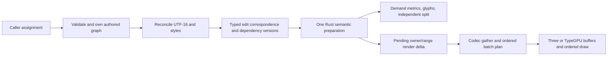

# Historical retained-text architecture proposal — 14 October 2026

This is the preserved pre-reconciliation proposal. Its observations refer to their dated artifacts; it is not the active execution plan. Use [the reconciled final plan](final-performance-architecture-plan.md) for current status and next actions.

## Recommendation and decision boundary

Preserve **one synchronous preparation executor** and carry its change evidence through query and renderer publication. Keep the current packed renderer representation for now. First make invalidation precise across the existing stages and account for every point where a small logical delta becomes a broad physical operation. Extend the existing flow convergence and record-rope framework with a derived summary only after an exclusive profile shows that stage dominates a current workload and a compact, correct continuation proof exists. Treat stable segmented publication as a **conditional second storage phase**, requiring proof that packed movement or ordered topology consumes enough end-to-end time to repay its new indirection, memory, ABI and renderer cost. This is one architecture with a conditional storage choice, not three competing pipelines.

This report was authored under the earlier implementation freeze. The user subsequently set the active evidence-first orchestration goal in the [frontier checklist](../planning/publication-frontier.md); that goal now governs execution and delegation. Conditional algorithms still require their evidence and proof gates. The current worktree and held stack are preserved; no merge or release is authorized. The accepted [preparation/publication contract](../planning/decisions/retained-prepare-publish.md) remains the behavioral authority. Historical instructions below its historical-record boundary are suspended.

The explicit objective is a lower end-to-end cost for an equivalent operation, at acceptable p95/tail and delivery size, without losing correctness or a second semantic executor. A local reduction in Rust work does not count if codec gathering, ordered-plan reconstruction, host buffers or uploads restore the same whole-root cost.

## Evidence ledger: observations, inferences and gaps

| Area                        | Established observation                                                                                                                                                                                                                                                                                                               | Design inference or remaining unknown                                                                                                                                                                                                                                                                                                                                                                          |
| --------------------------- | ------------------------------------------------------------------------------------------------------------------------------------------------------------------------------------------------------------------------------------------------------------------------------------------------------------------------------------- | -------------------------------------------------------------------------------------------------------------------------------------------------------------------------------------------------------------------------------------------------------------------------------------------------------------------------------------------------------------------------------------------------------------- |
| Frozen package comparison   | Package `346eda0c…` versus pinned main `c2ea9cef…` / `2f62d6b`: 76 faster, 16 slower, 33 neutral, four clock exclusions; workload median p50 2.200→2.040 ms across 125 comparable workloads. Input hashes match.                                                                                                                      | The 7.7%/10.3% clock drift and 9.07-second baseline archive read prevent an acceptance or causal magnitude claim. This is neither a current-source measurement nor a published-0.1.0 release comparison. Summary (local-only `.cache/retained-prepare-publish-wave1/full-346-main/labs/summary.md`), interference (local-only `.cache/retained-prepare-publish-wave1/full-346-main/timing-interference.json`). |
| Slow families               | Long one-character edit+measure 1.02→3.67 ms; 1,024 Text publication 20.47→26.09 ms; 512-label rewrite 10.84→13.22 ms; width inspection+publish 9.96→12.07 ms in that diagnostic run.                                                                                                                                                 | These suggest distinct preparation, bulk and demand/publication questions. They do not identify an exclusive hot stage for `346`. The other 12 slower rows and four exclusions remain in the saved comparison, not collapsed into one cause.                                                                                                                                                                   |
| Earlier scoped CPU captures | Related `d73b` bulk 1,024 setup-excluding preparation p50/p95 17.553/23.033 ms; setter+publication 24.561/27.950 ms. V8 samples included shaping, gather, render-plan and JS work; GC self was small in those particular captures. Earlier hero and tail-prefix profiles have authenticated but different artifacts and workloads.    | Stage samples are leads only. Inclusive samples overlap; samples are not elapsed milliseconds or current-source attribution. A storage redesign selected from them alone risks moving cost rather than removing it.                                                                                                                                                                                            |
| Current source              | `prepare_unicode` adopts the preflight Unicode candidate; there is one producer. Dirty-owner tracking and ordered correspondence exist. Flow has a `rebuild_until_state_converges` path with a retained suffix.                                                                                                                       | Do not add a duplicate Unicode pass, dirty-owner tracker, flow executor or speculative query adoption. Measure admission/fallback of the existing convergence path before extending it.                                                                                                                                                                                                                        |
| Current materialization     | Unicode analysis clears and rebuilds UTF-8, breaks, grapheme and script vectors outside limited reuse; `codec_gather` shares clean source rope gaps but copies packed glyph, slot and field rows with `extend_from_within`; complete topology retains mapping then revisits records. `copy_glyphs` scans source glyphs to select IDs. | A record rope alone does not yield edit-sized Unicode, copy or physical publication. These paths could be material, but their current exclusive time, bytes and frequency are unmeasured.                                                                                                                                                                                                                      |
| Delivery and compatibility  | Shaper 1,622,359 raw / 599,655 gzip bytes versus main 1,456,090 / 534,013: +166,269 / +65,642 bytes. Existing exports map reportedly matches main; eight declaration files differ and a private declaration moved.                                                                                                                    | Binary growth and declaration equivalence remain open gates. Do not use source-line count, prior artifacts or a matching exports map as full API/ABI proof.                                                                                                                                                                                                                                                    |

Before using any saved profile to decide an implementation, authenticate its package, source maps, Wasm and fixture/input hashes against the **current** source and the exact operation. A profile of `d73b`, `7f`, `2a86`, `5735` or `a475` cannot be relabeled `346` or a later dirty head. No new measurement is authorized by this document.

## Cost model and ownership of each bottleneck

Use these dimensions consistently: `n` is the larger old/new UTF-16 length; `s` is the number of caller-authored fields and span records that must be examined; `N` is live owner count; `k` is owners with pending semantic/render dirt; `e` is changed UTF-16 units; `q` is scalar-aligned edit windows; `G` is positioned/gather records; `d` is changed output records; `J` is records after the first changed packed ordinal; `F` is active bytes per record across all codec lanes; `U` is Unicode units actually analyzed; `H` is units passed through shaping; `B` is clusters/break opportunities visited; `L` is lines recomposed; `M` is CPU bytes copied or rewritten into physical storage; `P` is bytes offered for GPU upload; `p` is host patch intervals; `C` is host/Wasm crossings; `h` is retained-tree height and `c=32` its current fixed leaf capacity. `T_shape(H,font)` and `T_unicode(U)` denote actual library costs, because these sources do not prove that all font and Unicode algorithms take constant time per unit. Auxiliary memory means transient scratch beyond retained input/output; retained memory includes caches, old generations still leased and GPU staging.

An arbitrary new full string and mutable span graph have information lower bounds Ω(`n`) and Ω(`s`) to discover all possible changes unless a trustworthy immutable package-owned identity certifies equivalence. That lower bound does **not** require Ω(`n`) Unicode/shaping/layout or Ω(`N`) publication after discovery. Conversely a cold/dense result requires Ω(output records and bytes), and an independent split requires Ω(selected output bytes). `C` contributes fixed dispatch/encoding cost per call even when no glyph work occurs; the coefficient is measured, not assumed. End-to-end CPU is the sum of actually executed ingress, reconciliation, Unicode, shaping, flow, gather, topology and host work; GPU queue latency is a separate critical path. Record these counts alongside **exclusive** CPU and p50/p95. “Typical” below means an explicitly admitted local case, **not** a statistical claim about users.

| Current operation, derived from code                                                                      | Best / admitted local case                                                                                                                                                                                                                                                               | Broad or adversarial case                                                                                                                                                                                                                                                                                                                                                                                          | Auxiliary and retained space                                                                                                                                                                                                                              |
| --------------------------------------------------------------------------------------------------------- | ---------------------------------------------------------------------------------------------------------------------------------------------------------------------------------------------------------------------------------------------------------------------------------------- | ------------------------------------------------------------------------------------------------------------------------------------------------------------------------------------------------------------------------------------------------------------------------------------------------------------------------------------------------------------------------------------------------------------------ | --------------------------------------------------------------------------------------------------------------------------------------------------------------------------------------------------------------------------------------------------------- |
| Three setter and full wire input (`text.ts` 969; `render-planner.ts` 1157)                                | A proven no-span same-value assignment can return after public object/string equality; `C=0` to Rust. Other valid assignments inspect required `s` fields and encode up to `n` units.                                                                                                    | Arbitrary full replacement needs Ω(`n+s`) inspection/encoding; span sorting or normalization may add more, so this review does not assert a tighter upper bound for all caller graphs. A thousand small synchronous setters pay `C≈1000` crossings when each changes.                                                                                                                                              | Candidate authored snapshot/wire O(`n+s`) transient in the broad case, plus retained desired state. No claim that JavaScript string equality is worst-case O(1).                                                                                          |
| Rust reconciliation (`state.rs` 6892–7140)                                                                | One same-length comparison loops over all `n` units in two-u16 SWAR steps, emits `q` windows and changes `e` IDs; full replacement prefix/suffix also scans up to `n`. Even `e=1` gives Θ(`n`) comparison after a new full input.                                                        | `q` can approach `n` for alternating changed units; length-changing scattered edits collapse into one envelope covering nearly `n`, with O(`n`) identity/candidate copying.                                                                                                                                                                                                                                        | `TextEdit` metadata O(`q`); pending UTF-16 and unit-ID buffers O(`n`) alongside committed buffers. SWAR improves the scan coefficient, not its Θ(`n`) bound.                                                                                              |
| Existing record rope (`retained_rope.rs` 19, 219, 244, 861)                                               | AVL-height-balanced split/join of shared 32-record leaves changes O(`h`) nodes plus O(`c`) boundary copying, `h=O(log(G/c+1))` for the tree itself.                                                                                                                                      | Replacing/emitting `d` records costs Ω(`d`); multiple spans cost their visited nodes. Absolute moved-suffix coordinates or a downstream flat consumer can still cost Ω(`J`) even when the rope shares suffix nodes.                                                                                                                                                                                                | O(`h+c+d`) newly allocated nodes/records for an edit before old snapshots retire; retained old roots/pages increase peak live memory. Count/source-coverage summaries are constant-size, but they do not summarize Unicode or render bytes.               |
| Unicode/bidi/shaping (`unicode.rs` 62; `state.rs` 3100, 4556, 4815)                                       | Certified ASCII-letter edits can reuse committed Unicode, so `U=0`; unchanged bidi style can skip bidi; existing safe shaping windows can make `H` local.                                                                                                                                | Any unsupported contextual edit uses `U≈n` and may trigger paragraph bidi or whole-run shaping (`H≈n`). HarfRust complexity is `T_shape(H,font)`, not a proved O(`H`) bound.                                                                                                                                                                                                                                       | Existing Unicode flat output and pending analysis use O(`n`) retained/transient capacity; shaped/cluster output is proportional to glyph/cluster counts. Future B summaries add O(chunks×state_size) only if state size is bounded.                       |
| Flow and positioning (`state.rs` 5351, 5812; `flow_composition.rs` 801)                                   | When the existing guard admits and continuation converges, work follows examined `B` opportunities and `L` recomposed lines plus positioned output actually changed.                                                                                                                     | A width, bidi, drop-cap or unsafe boundary can propagate to the paragraph end: `B` may be Θ(`n`) even with `L=1`, and `L` may equal all lines. Positioning can copy retained semantic/glyph slices, which must be counted in `M`.                                                                                                                                                                                  | Flow rope shares clean chunks, but pending lines, boundary shapes and positioned flat slices consume space proportional to recomposed/retained output; no O(`L`) claim without `B`.                                                                       |
| Owner route and packed publication (`state.rs` 2781, 1793; `codec_gather.rs` 1160; `ordered_plan.rs` 817) | `prepare_retained_order` visits `k` queued IDs, calls `paragraph`'s binary search over `N` sorted owners for each, then unstable-sorts `k` `(order,id)` pairs: O(`k log(N+1)+k log(k+1)`) comparisons, without scanning all `N`. Same-count tail replacement can retain a packed prefix. | Clean gaps inside an envelope copy Θ(`gap_records×F`) bytes; front count changes can make `M=Θ(JF)`. `retain_input_slots` at `ordered_plan.rs:1011` loops every retained mapped record; complete topology then loops post-prefix records, yielding Θ(`J`) visits even for `k=1`. A dense edit that changes all `G` output records has Ω(`GF`) output work; `k=N` alone does not prove that all glyph bytes change. | Owner scratch O(`k`); correspondence O(`k`) for bounded intervals; packed glyph/field candidate and `retained_input_slots`/input mappings are O(`G`) when full topology is built. Rope sharing does not eliminate these arrays.                           |
| Host patch and upload (`host-buffer.ts` 79, 85; `typegpu/renderer.ts` 65, 219)                            | With one small patch, host operations and upload are proportional to its byte length plus one dispatch.                                                                                                                                                                                  | Three's one-span-per-buffer min/max policy can give `P≈buffer_span` for two far-apart patches; TypeGPU merges at most 32 ranges then collapses, so its `P` can also approach full span. Patch copy/fill work adds `M`; buffer resize copies old bytes and allocates new bytes.                                                                                                                                     | Three keeps one upload descriptor per buffer; TypeGPU up to 32 ranges per buffer. CPU retained arrays and GPU buffers are O(capacity bytes), and old/new generations may coexist until retirement. `P` is offered bytes, not measured GPU execution time. |
| Selected split (`text.ts` 1060; `state.rs` 1108)                                                          | With requested `m=G`, scanning `G` records and copying `m` is natural output work.                                                                                                                                                                                                       | With `m≪G`, current sorted-ID binary search on each source record is O(`G log m + m log m`) membership/sort work, plus Ω(`mF`) copying and possibly O(`G`) initial placements demand.                                                                                                                                                                                                                              | Requested IDs O(`m`), owned glyph/semantic/placement output O(`m`) plus its independent renderer resources; an optional persistent lookup would add O(`G`) retained metadata.                                                                             |

These are loop-derived work bounds, not fitted latency equations. For example, the tree's `h=O(log(G/c+1))` follows its AVL height balancing in `join_nodes`/`balance`; it does **not** apply to `collect_text_edits`, absolute source-coordinate rebasing, flat Unicode arrays, `retain_input_slots`, physical copies, order-vector rewriting, host uploads or the result bytes. A faster leaf scan, bigger SIMD unroll or improved cache locality changes coefficients and may grow Wasm; none turns Θ(`n`) discovery or Θ(`JF`) suffix movement into O(log `n`). Reserved `Vec` capacity can make repeated appends cheap on average, but a growth/reallocation operation may copy its entire live capacity; `M` and peak memory must count that event, and neither amortization nor median latency bounds a single synchronous setter's p95. For a retained cache, include both the O(`G`) build/maintenance and O(`G`) memory in the lifetime cost before crediting a sparse query. Any proposed end-to-end bound must add the largest downstream term that its consumer actually executes.

| Bottleneck                                | Classification and disposition                                                                                                                                                                                                                                                                                                             |
| ----------------------------------------- | ------------------------------------------------------------------------------------------------------------------------------------------------------------------------------------------------------------------------------------------------------------------------------------------------------------------------------------------ |
| Caller trust, span ownership and encoding | Public mutable graphs require validation and encoding at the entry. Reuse package-owned immutable provenance downstream, while preserving getter/error order, inherited feature fields and live binding guards. Current unchanged assignment overhead may be here; exclusive evidence is missing. Keep one owner and no validation bypass. |
| Text reconciliation                       | Keep current packed/SWAR comparison and prefix/suffix envelope for full replacement. A faster scan lowers a constant, not the Ω(`n`) input boundary. Multiple interior islands need separate evidence and a correspondence proof before added metadata.                                                                                    |
| Unicode, bidi and shaping                 | Most derived Unicode columns are flat and rebuilt; bidi/contextual shaping can propagate beyond the edit. Investigate B only if current profiles show this dominates long edits. Keep full recompute as the same executor's broad case, not a parallel fallback implementation.                                                            |
| Flow                                      | Existing restart/convergence/suffix sharing is retained. Determine why it is or is not admitted for width/context edits; count `B` as well as `L`. An equal break offset alone is insufficient.                                                                                                                                            |
| Copy and inspection                       | Demand summaries are already lazy. `copy_glyphs` currently scans all source glyphs; selected output allocation/copy remains necessary. Add a generation-aware lookup only if the source scan dominates measured selected-copy latency and its retained index pays for itself.                                                              |
| Gather, topology and host publication     | Dirty owners and source correspondence are retained, while packed clean gaps still copy and topology can revisit all records. This is C's candidate cause, not evidence that C wins. Test `M`, visited records, host copies, draw topology, upload bytes and actual p95 before changing representation.                                    |
| Calls, allocation, GC and delivery        | Synchronous per-set fixed cost matters for many small labels. Profile crossing/encoding separately from shaping; do not hide eager preparation by deferring it. Attribute live/peak bytes, GC, monomorphized Wasm code and runtime JS before adding an index or segmented pages.                                                           |

## One data and delta contract



The delta needs old/new source and record coordinates, stable owner/paragraph identity, stage invalidation reason, semantic revision and dependency versions. Dirty flags choose stages; ranges and correspondence bound work; they are not interchangeable. Keep one canonical delta in Rust and project only the fields required by the current ABI and renderer. No second JS semantic planner. Preparation may share old immutable rope chunks, but the committed prepared revision owns its results and its dirty publication description. Queries consume that revision; publication consumes accumulated dirt without re-encoding or reshaping it. A same-value assignment can reuse it after the public trust check. A later assignment may coalesce renderer dirt but cannot erase the semantic revision seen by a synchronous intervening query.

For the current compact path, keep 32-record Arc rope leaves for retained source/flow records and packed arrays for hot glyph/field traversal. They have different locality jobs. Do not convert every derived column to a rope. When a measured Unicode stage merits B, use stage-specific aligned secondary summaries or break structures: leaves keep compact transition/summary state, interior nodes compose it, and materialized flat output is produced only where its consumer actually needs it. Where a state is not compact or the dependency expands widely, recompute that stage broadly in the same executor. Preserve contiguous codec fields and the current dense path until a C gate is met; cold mount, 1,024 dirty owners and long contextual text should remain simple sequential work.

An exact summary must compose in source order with an identity and associative `combine`; regrouping and checked overflow must not change results. Stateful boundaries need an explicit `incoming state → outgoing state + boundaries` transition rather than a claimed additive count. Cache keys include font, feature/style, direction, Unicode version, flow geometry and any context actually used. Reuse a suffix only with unchanged source correspondence, equal incoming stage state and equal dependency versions. RI parity is one possible compact grapheme component, not a full Unicode or bidi proof. Neutral scripts, combining/ZWJ sequences, malformed surrogate treatment, bidi paragraph direction, contextual shaping and fallback font changes are explicit adversarial cases. HarfRust safe boundaries and pinned Unicode conformance, not equal code units alone, decide shaping reuse.

For line flow, preserve the existing convergence evaluator: restart before the affected boundary; compare cursor/cluster and source correspondence, break correction, metrics, remaining region/slot state and drop-cap effects before splicing the suffix. Width or exclusion changes may move every later line. Count examined clusters/opportunities to detect an O(`n`) one-line scan hidden by `L=1`. A full recomputation oracle must compare glyph IDs/positions, scripts/bidi, breaks, flow, selection identities and render records across randomized chunk boundaries and adversarial edits.

## Conditional publication storage decision

**A: packed storage plus precise invalidation** is the default physical design. It preserves cache-friendly contiguous codec lanes and the existing renderer ABI. It can eliminate unnecessary stage work and whole-root gathering when count and batch topology permit, but front count changes can still copy a suffix. Name and measure that bound openly.

**B: derived incremental summaries and proven convergence** extends A's semantic stage model. It is warranted when current long-edit profiles attribute a material exclusive cost to Unicode/shape/flow that survives publication. It is not a universal rope conversion, and it does not fix packed suffix movement. Retain the current flow convergence path and test its miss reasons first.

**C: stable segmented publication/order indirection** replaces only the physical publication representation if current profiles show packed `M` or topology visits dominate meaningful regressions after A/B. A plausible representation is bounded contiguous pages per batch key with stable `(page, slot, generation)` physical locations, a separate logical paint-order sequence, and a renderer-neutral changed-page/draw description. Pages keep SoA codec fields locally contiguous; dense output uses a sequential writer. An ordered index/indirect stream or batched draw descriptors must preserve transparent order and direct/indexed parity without producing one draw per page. If front insertions rewrite a suffix of that index stream, C has only moved the bottleneck. That alternative must be quantified before adoption.

For C, specify physical-page slack, maximum occupancy, free-slot reuse, compaction trigger, total/live/peak bytes, and a bounded per-publication compaction budget. An amortized claim needs a potential argument **and** a worst-operation cap; an old page cannot be reclaimed while borrowed views, accepted renderer commands or GPU in-flight reads may still refer to it. Stable slots are not stable text identity: owner IDs and semantic glyph IDs survive only under their defined generation rules. Transparent paint order follows logical order, even if physical pages do not move. A `k=N` or high-density case may choose a full checkpoint through the same compiler, subject to an explicit measured threshold, never a parallel publication executor.

C is rejected for this milestone if complete ordered topology, host materialization, GPU upload or index rebuilding remains linear with the same coefficient; if it increases draws or p95 enough to erase CPU savings; if memory/ABI complexity cannot meet the size budget; or if A/B already resolves the material end-to-end regressions. This is a falsifiable gate, not a commitment to build C.

## API, failure and lifetime contract

Public `Text` setters, `measure`, glyph/caret/selection reads and `split` keep their synchronous signatures unless a separately justified public change is approved. Bound setters finish semantic preparation or throw at that call. First-demand summaries may serialize prepared data, but must not repeat semantic preparation. An unbound Text can retain authored values until binding. A split/copy owns its geometry, metadata and resource leases independently of siblings; it may copy selected output, but must not require whole-root publication merely to find it. Stable IDs used for selected copies must be checked against paragraph/revision/generation and returned in the required selection/paint order. The current linear `copy_glyphs` selection scan is a performance question, not evidence of shared copy ownership.

Existing `pmndrs_glyph_engine_update`/`update_batch`, measurement/borrow and `copy_glyphs` Wasm calls, `abi_contract.rs`, generated `text-shaper-abi.ts`, `PlanTransport`, `render-planner.ts`, Three `Text`/group and TypeGPU/Three consumers form the review inventory. A/B should stay internal to Rust and its current request/result descriptors where possible. C would need a versioned renderer-neutral plan descriptor for page identity/generation, logical order, changed ranges, buffer IDs/offsets, capabilities, checkpoint and retirement; it must update generator and all consumers together. Recheck all changed `.d.ts` files, exports, status/error values, encoded bounds and borrowed-view lifetimes. No unpublished ABI field may be assumed safe simply because the exports map matches.

```mermaid
stateDiagram-v2
  [*] --> Clean
  Clean --> PreparedDirty: valid setter commits semantic revision
  PreparedDirty --> PreparedDirty: setter or demand read
  PreparedDirty --> Clean: renderer accepts current publication
  PreparedDirty --> PreparedDirty: renderer rejects; checkpoint required
  PreparedDirty --> NeedsRepair: invalidating preparation/adoption defect
  NeedsRepair --> PreparedDirty: explicit valid rebuild
  Clean --> Retired: teardown
  PreparedDirty --> Retired: teardown
  NeedsRepair --> Retired: teardown
```



This is a proposed state abstraction, not a claim about the current enum names. Semantic revision and accepted publication generation are separate. A renderer rejection **preserves** prepared semantic state, throws at the publication call and requests a later explicit checkpoint; a query must not initiate a hidden retry. A failed caller validation leaves accepted state unchanged. An unexpected post-write preparation/adoption defect may invalidate derived state and requires an explicit rebuild through the same executor; its exact recovery contract is still a decision gate. Empty publication does not release the host publisher. Teardown, paragraph removal, font/material leases, staged transport, borrowed result views and independent split copies each have their existing release fence; no new lifetime coordinator should shadow them.

Publication bytes and GPU-visible buffers remain immutable while accepted or in flight. A synchronous CPU return does not retire GPU reads. Any C page reuse or compaction must use a proven backend upload-copy guarantee or a generation/fence retirement rule for both Three and TypeGPU. Renderer rejection cannot expose half-adopted host bindings or old bytes as a successful new frame. Do not label existing staged swaps as deep rollback copies; inspect allocation and live-byte measurements before retiring scratch that supports transactional preparation.

## Bounded decision and implementation sequence

1. **Freeze/provenance inventory.** Record the exact current source tree and package SHA, source maps, Wasm, declarations and benchmark closure. Keep the 346/main diagnostic result qualified. Inventory saved profiles by artifact and operation; use the bounded append-log reader for any agent trace. No implementation or new timing is implied.
2. **Record missing exclusive evidence after explicit authorization.** Target long edit+measure, unsafe/contextual reflow, width inspection and inspection+publication, unchanged/small setter, 512/1,024 owner rewrite/publication, front/middle/tail count change and selected copy. Separate `set`, `set+read`, `set+publish`, `set+read+publish`, and copy. Vary `n`, `s`, `N` and `k` independently. Capture stage-exclusive CPU, p50/p95, `U/H/B/L`, source/record/host bytes moved, allocation/GC, Wasm calls, draw/buffer/upload counts and backend. Use the named repository workflow; no ad hoc server or favorable-clock rerun.
3. **Choose A/B/C gate in milliseconds and bytes.** Identify which measured slowdown is due to trust/encoding, analysis, shaping/flow, copying, packed relocation, ordered topology or host/GPU work. Compare expected recovered milliseconds to added per-set fixed cost, memory, p95 and Wasm/JS size. Set a concrete delivery budget and require a deletion inventory; the current +65,642 gzip shaper bytes require attribution or justified reduction. If stage attribution does not distinguish causes, no storage change is selected.
4. **Proof before code.** Specify transition/summary composition and cache keys for B; source/record correspondence, logical order, generation, page/borrow and GPU fences for C; invalidation and failure transitions for all. An independent cold recomputation oracle, Unicode grapheme/line-break and bidi conformance, shaping boundary/font variation cases, randomized edit/lifecycle tests, and renderer order/visual checks must distinguish correctness from self-consistency.
5. **Only after review and approval:** implement one bounded stage in the existing executor, retire its superseded path, verify focused then broad checks, compare frozen exact artifacts and current main/release separately, and inspect end-to-end p95, binary and browser/GPU effects. Stop if downstream materialization cancels the stage's gain. C, if still justified, is a later representation migration with an ABI and backend acceptance gate of its own.

The unresolved decisions are: acceptable eager-set cost for repeated/small labels; whether B has a compact correct state for the measured Unicode/shaping cases; whether packed count-change movement materially dominates; C's order/indirection and compaction budget; explicit invalid-state repair behavior; and the public declaration/binary-size disposition. Saved evidence does not choose those values. The proposal is ready for architecture review, not implementation acceptance.

## Source-anchored execution map

Line anchors below refer to the reviewed frozen worktree plus preserved dirty changes on 13 October, not to `main` or an older package. The linked code is the authority if subsequent edits move a line. This map distinguishes **present behavior** from a proposed change; a reader should not infer that every stage is absent because it appears in an optimization plan.

| Call edge and concrete owner               | Present behavior and exact point where work can expand                                                                                                                                                                                                                                                                                                                                                                                                                                                                                                                                                                                                                                                                                                                                                                                                                                                                                                                                                                                                                                                                                                                                                                                                                                                                                                                      |
| ------------------------------------------ | --------------------------------------------------------------------------------------------------------------------------------------------------------------------------------------------------------------------------------------------------------------------------------------------------------------------------------------------------------------------------------------------------------------------------------------------------------------------------------------------------------------------------------------------------------------------------------------------------------------------------------------------------------------------------------------------------------------------------------------------------------------------------------------------------------------------------------------------------------------------------------------------------------------------------------------------------------------------------------------------------------------------------------------------------------------------------------------------------------------------------------------------------------------------------------------------------------------------------------------------------------------------------------------------------------------------------------------------------------------------------- |
| Assignment enters Three                    | [`Text.set` and `#applyUpdate`](../../../packages/glyph/src/three/text.ts) at lines 969–1011 validate the update, perform a narrow no-span same-string return, normalize a new desired state, then call `#binding?.stageUpdate`. [`ThreeRootPublication.stageUpdate`/`#stage`](../../../packages/glyph/src/three/text.ts) at 1531 and 1817 build `coreTextState`, bind span resources, and call the existing handle's `update`. This is a synchronous public call; a failed candidate throws here. An unbound Text has no binding call at this step.                                                                                                                                                                                                                                                                                                                                                                                                                                                                                                                                                                                                                                                                                                                                                                                                                        |
| JS semantic preparation                    | [`RetainedTextImpl.update` → `RenderPlannerImpl._updateText`](../../../packages/glyph/src/internal/render-planner.ts) at 1655 and 697 resolves desired options, computes style/geometry dirt, and invokes `#prepareTextCandidate` before adopting the desired state. At 1157–1224 it sends a **full authored replacement** as one `textMutation {start:0, deleteCount: old UTF-16 length, insert: new string}` and requests a summary only if already demanded. This full wire input is not a claim that Rust recomputes the whole paragraph.                                                                                                                                                                                                                                                                                                                                                                                                                                                                                                                                                                                                                                                                                                                                                                                                                               |
| Wasm boundary and preflight                | [`PlanTransport.prepareParagraph`](../../../packages/glyph/src/internal/handle-state.ts) at 1376 encodes the request and invokes [`pmndrs_glyph_engine_measure_paragraph`](../../../packages/glyph/rust/shaper/src/wasm.rs) at 971. [`TextEngine::measure_paragraph_inner`](../../../packages/glyph/rust/shaper/src/engine/state.rs) at 1367 validates lifecycle/requests and prepares only the queried paragraph, without renderer gather or publication revision. [`validate_planner_inputs`](../../../packages/glyph/rust/shaper/src/engine/state.rs) at 6045 validates text/style and drives the preflight candidate.                                                                                                                                                                                                                                                                                                                                                                                                                                                                                                                                                                                                                                                                                                                                                   |
| Reconciliation and single Unicode producer | [`validate_style_topology_for_inputs`](../../../packages/glyph/rust/shaper/src/engine/state.rs) around 3100–3240 computes `TextEdit` windows via `text_reconciliation`/`collect_text_edits` at 6892–6988, then either reuses committed Unicode for same-length ASCII-letter edits or calls `UnicodeAnalysis::analyze` once on the candidate. [`ParagraphState::prepare_text`/`prepare_unicode`](../../../packages/glyph/rust/shaper/src/engine/state.rs) at 4295 and 4519 install stable unit IDs and adopt that candidate; `prepare_unicode` is **not another analyzer**. Full replacements with count change collapse to one prefix/suffix envelope; same-length input can yield multiple scalar-aligned edits.                                                                                                                                                                                                                                                                                                                                                                                                                                                                                                                                                                                                                                                           |
| Semantic stage chain                       | [`ParagraphState::prepare`](../../../packages/glyph/rust/shaper/src/engine/state.rs) at 4071 runs text → Unicode → styles → bidi → shaping runs → shape → clusters → geometry/flow/positioning. `prepare_styles` at 4400 realigns/validates/resolves spans and computes `StyleInvalidation`; `prepare_bidi` at 4556 can skip when Unicode is proven reusable and no bidi-style invalidation, otherwise analyzes the paragraph; `prepare_shaping_runs` at 4590 rebuilds when its dependencies changed. [`try_prepare_incremental_shape`](../../../packages/glyph/rust/shaper/src/engine/state.rs) at 4815 already tests run/fallback topology and safe sparse windows, with whole-run fallback. [`prepare_clusters`](../../../packages/glyph/rust/shaper/src/engine/state.rs) at 5125 already has style refresh and one-run rebuilding.                                                                                                                                                                                                                                                                                                                                                                                                                                                                                                                                      |
| Flow and positioning                       | [`prepare_flow_lines`](../../../packages/glyph/rust/shaper/src/engine/state.rs) at 5351 first tries existing exclusion-band or text-dirty convergence under explicit guards, then uses full `build_with_drop_cap_context` when they do not admit. [`FlowLayoutArena::rebuild_until_state_converges`](../../../packages/glyph/rust/shaper/src/engine/flow_composition.rs) at 801 and its continuation test at 1047–1061 compare dirty end, cursor, correction, metrics and drop-cap context before sharing a suffix. [`prepare_geometry_and_layout`](../../../packages/glyph/rust/shaper/src/engine/state.rs) at 4124 can prove a geometry-only flow/positioning equivalent and avoid the tail. Otherwise `prepare_positioned` at 5812 copies/rebuilds the needed positioned columns. Width-only geometry is not generally covered by the text-dirty convergence guard.                                                                                                                                                                                                                                                                                                                                                                                                                                                                                                      |
| Demand read                                | [`Text.measure`/`#measureText`](../../../packages/glyph/src/three/text.ts) at 1017/1577 reaches `RetainedTextImpl.measure`; [`#assertTextQueryable`](../../../packages/glyph/src/internal/render-planner.ts) at 1561 requests a first summary from the prepared revision if absent. Glyph borrowing at 905 and [`PlanTransport.borrowParagraphLayout`](../../../packages/glyph/src/internal/handle-state.ts) at 1443 read prepared columns, with a callback-scoped borrow. A first summary call is a Wasm call but not a second semantic preparation.                                                                                                                                                                                                                                                                                                                                                                                                                                                                                                                                                                                                                                                                                                                                                                                                                       |
| Independent split                          | [`Text.split`](../../../packages/glyph/src/three/text.ts) at 1060 obtains placements, excludes incomplete glyphs, captures stable IDs and creates independent Glyphs/decorations. [`_copyGlyphs`](../../../packages/glyph/src/internal/render-planner.ts) at 942 calls [`PlanTransport.copyGlyphs`](../../../packages/glyph/src/internal/handle-state.ts) at 1472 and [`TextEngine::copy_glyphs`](../../../packages/glyph/rust/shaper/src/engine/state.rs) at 1108. The latter sorts requested IDs but **scans all positioned source glyphs**, emits selected glyph/semantic columns in source order, translates selected placement slots, and compiles an owned checkpoint. Root gather is not the lookup mechanism.                                                                                                                                                                                                                                                                                                                                                                                                                                                                                                                                                                                                                                                       |
| Publication and renderer                   | [`_stageBatch` → `adopt` → `consume` → `settle`](../../../packages/glyph/src/internal/render-planner.ts) at 997–1078 compiles lifecycle/order work, invokes [`pmndrs_glyph_engine_update_batch`](../../../packages/glyph/rust/shaper/src/wasm.rs) at 644 through transport, then offers a borrowed candidate synchronously. [`TextEngine::prepare_update_inner`](../../../packages/glyph/rust/shaper/src/engine/state.rs) at 1572 checks revisions, and at 1793–1967 visits pending/prepared owner IDs, chooses retained or full gather, and hands `ChangedIntervals` or `Replacement` correspondence to the ordered compiler. Rejection in `consume` at 1054–1072 preserves semantic preparation and increments the checkpoint generation.                                                                                                                                                                                                                                                                                                                                                                                                                                                                                                                                                                                                                                 |
| Delta expansion and host bytes             | [`CodecGatherWorkspace::append_retained_stream`](../../../packages/glyph/rust/shaper/src/engine/codec_gather.rs) at 563 and its clean-gap copy at 1160–1197 share source rope ranges yet copy each gap's packed glyph, placement and every active f32/u32 lane with `extend_from_within`. [`OrderedPlanCompiler::prepare_complete_topology`](../../../packages/glyph/rust/shaper/src/engine/ordered_plan.rs) at 817 retains slot correspondence but loops over input glyphs after the prefix at ~912, even for clean mapped records. Three [`#stageBoundBufferMutations`](../../../packages/glyph/src/three/command-buffer-renderer.ts) at 533 collects patches, then [`commitBufferMutations`](../../../packages/glyph/src/three/internal/host-buffer.ts) at 85 writes/copies host bytes and uploads. Three currently merges **all patches for one buffer into one min/max upload span** at `includeMutationRange` line 79; TypeGPU [`decode`](../../../packages/glyph/src/typegpu/internal/renderer.ts) at 65 coalesces multiple upload ranges up to 32 and [`commit`](../../../packages/glyph/src/typegpu/internal/renderer.ts) at 219 submits `queue.writeBuffer`. A small semantic delta can therefore become clean-gap copies, topology visits, a wide Three upload or draw reconstruction. These are source mechanisms, not measured current bottleneck attribution. |

The retained [`RopeSummary`](../../../packages/glyph/rust/shaper/src/engine/retained_rope.rs) at 19–49 contains `records`, `fragments` and source coverage for 32-record leaves. It does **not** contain Unicode, bidi or rendering payload summaries. The owner frontier at [`PlannerState`](../../../packages/glyph/rust/shaper/src/engine/state.rs) 232–260 already stores `pending_preparation_ids` and `unpublished_preparation_ids`; [`prepare_retained_order`](../../../packages/glyph/rust/shaper/src/engine/state.rs) at 2781 orders only those owners if cached ranges remain valid. This is a useful existing mechanism, not a proposed new index.

## Worked state transitions (schematic, not timings)

In these examples `p7` is paragraph identity, `r` is semantic preparation revision, `g` is accepted renderer generation, `u_i` are UTF-16 unit identities, and `q_j` are stable glyph identities. Source coordinates are UTF-16 offsets; gather record coordinates count drawable records and need not match source offsets. Bracketed intervals are half-open. An `old → new` pair describes logical correspondence; it does **not** imply the implementation sends those exact intervals on the wire. `b` means codec bytes per record summed across active lanes; `m` means selected glyph count. All numbers below are examples only.

1. **Unchanged full assignment.** Suppose `p7` has `"abc"`, unit IDs `[u1,u2,u3]`, record IDs `[q1,q2,q3]`, revision `r=8`, renderer `g=5`. `text.set({text:'abc'})` with no spans hits the explicit Three same-string return before a Wasm call. With a richer update object, normalization/equality can still return after its public-input work. If a full replacement reaches Rust, `SameLength` comparison scans Θ(`n`) units even though `TextEdit=[]`, then discards the text candidate; there is no Unicode candidate or new semantic output. The required work is caller validation/equality appropriate to its shape; it is **zero shaping, flow, gather and upload bytes** only if no other property or lifecycle change exists. `r` and `g` remain unchanged. The fast return saves `C` and semantic work, but neither arbitrary string equality nor mutable-graph validation is assumed worst-case O(1).
2. **Sparse equal-length ASCII edits.** `"abc def ghi"` → `"axc def gxi"` enters JS as one full replacement `[0,11)→[0,11)`. Rust's `SameLength` path scans all `n=11` units and yields scalar-aligned `TextEdit` windows `[1,2)→[1,2)` and `[9,10)→[9,10)` (positions are illustrative for this exact string). Unchanged unit IDs survive; positions 1 and 9 take fresh IDs. Current preflight may reuse Unicode because both old/new units in each edit are ASCII letters, so `U=0` **after** Θ(`n`) discovery. Bidi can reuse if style direction is unchanged. Shaping-run preparation still sees prepared text; its existing safe-window routine can keep `H` near the windows if run/fallback boundary proofs pass, otherwise `H` can approach the whole run. Flow may converge after local `B,L`, or inspect the remainder. `r` advances on the changed preparation; `g` waits for publication. If both positions affect two output record intervals, the owner delta describes both; a later gather may copy Θ(`gap_records×F`) clean packed bytes and the ordered writer may traverse `J` suffix records. Two `e=1` windows therefore do not imply O(`e`) end-to-end work.
3. **Length-changing scattered edit.** `"abc def ghi"` → `"abXYc def gZhi"` has two insertions but the public wire still carries one full replacement. The current `FullReplacement` prefix/suffix scan takes Θ(`n`) in the worst case and finds a **single envelope** from the first insertion to the last, such as old `[2,9)→` new `[2,12)` after scalar seam adjustment. It does not represent two independent interior islands: even a wide unchanged middle is inside the envelope. Unit IDs outside can survive; units within are reassigned under the existing identity transaction. Preflight runs full `UnicodeAnalysis::analyze` (`U≈n`) unless a future certified regional algorithm exists; current shaping/run/flow may admit bounded work only under their independent proofs. A source suffix beginning after old 9 corresponds to a new suffix after new 12, but gather records must use their own old/new indices because glyph count may change independently of UTF-16 length. The source rope may share suffix leaves while absolute source metadata, packed record lanes or order mappings move Θ(`J`) records and `M≈JF` bytes. `r` advances before any query; `g` remains 5 until accepted publication.
4. **Contextual Unicode edit.** Replacing an ASCII scalar next to an emoji sequence with a ZWJ or modifying a regional-indicator run can change grapheme boundaries beyond the edited UTF-16 units. Preflight does **not** use the ASCII-letter shortcut; it analyzes the full candidate once (`U≈n`), then `prepare_unicode` adopts it. A bidi-control or strong-direction change can alter resolved levels beyond the local window; shaping and flow can then have `H≈n`, `B≈n` and all lines affected. This example has no certified compact convergence boundary in the current source. Its safe stage work is broad Unicode/bidi as required, followed by existing shaping and flow admission checks. Preserve independent cold equivalence and correct unit/glyph identities; never splice a suffix because offsets happen to match. Even a future transition summary has O(`n`) worst propagation when every downstream state changes.
5. **One dirty label among 1,024.** Assume 1,024 retained `Text` objects share a root, only `p7` changes while order, codec and glyph count remain fixed. Setter prepares `p7`; the existing owner vectors contain its ID. On publication, `prepare_retained_order` visits one ID and binary-searches the sorted owner array in O(log `N`) comparisons; sorting one pair is constant. `append_retained_stream` can skip other owners and issue one changed output interval when cache key/ranges and decoration guards hold. If instead glyph count or binding topology changes, replacement correspondence or full gather is possible. There is **no** guarantee that `M` or `P` equals `F×glyphs(p7)`: clean packed gaps may copy, `retain_input_slots` loops over retained mapped records, complete topology can visit `J`, and Three's min/max range may upload a wide span. `N=1024,k=1` bounds only owner admission by O(log `N`); it does not bound the whole operation by O(log `N`). With `k=N`, owner sorting and full output also grow at least linearly.
6. **Width-only reflow.** `p7` changes width but not text or styles. JS sends geometry at the same text preparation; unit IDs, Unicode, bidi and HarfRust glyph shapes should remain the semantic inputs (`U=H=0` for those reused stages). Current `prepare_flow_lines` can use the exclusion-band convergence path for a localized exclusion, but the text-dirty path requires geometry unchanged, so an ordinary width change may build flow broadly. If `flow_positioning_equivalent` proves identical positioning, the tail is discarded and renderer dirt may be empty; otherwise line breaks/positions and records change until the actual continuation stabilizes, possibly through the entire paragraph. Even a one-line paragraph may examine `B=Θ(n)` opportunities; `L=1` does not make this O(1). A later measure reads this prepared result; it must not reshape the text.
7. **Selected split.** `p7` contains `G=500` positioned glyphs; `Text.split()` selects `m=12` drawable stable IDs after reading placements and excluding incomplete glyphs. Current `copy_glyphs` sorts the requested IDs and scans all 500 source records, doing a binary search per source record, to emit the 12 selected records and their semantic/placement columns in source order. It creates a detached owned checkpoint with its own bindings/leases. The unavoidable output is Ω(`mF`) plus selected placement data; the current lookup is O(`G log m + m log m`) and a first glyph-layout demand may materialize O(`G`) columns. A retained ID→position index gives O(`m log m`) per query **after** an O(`G`) build and O(`G`) retained memory; it helps only when repeated sparse copies amortize that build. Sibling mutation/disposal must not mutate the copy. Root `g` need not advance merely to copy.

These examples expose three separate coordinates: authored UTF-16 units, positioned/gather record ordinals and physical buffer offsets. A single `delta_start` cannot safely stand in for all three. Identity survives only where the actual source/shaping correspondence proves it, not where offsets coincide after insertion.

## Bounded algorithms, exact admission rules and unresolved proofs

The implementable **A path** is a conservation/checkpoint discipline around existing stages. It uses current `TextEdit`, `ShapeWindow`, `layout_dirty`, `GatherCorrespondence`, owner vectors and cache keys rather than another dispatcher:

```text
input: accepted authored state, one validated full replacement, pending renderer generation
preflight: derive scalar-aligned TextEdit[] and one Unicode candidate (or certified reuse)
prepare: for each existing stage, derive exact dependency version and dirty closure
         run existing local path only if its current admission predicate proves reuse
         otherwise run that stage's existing broad path; commit one semantic revision
query:    read/materialize requested columns from that revision; no renderer plan
publish: sort only pending/unpublished owners when cached order/ranges permit
         carry old/new source AND record correspondence to gather and ordered plan
         materialize patches/checkpoint; record physical bytes and visited records
         accept renderer synchronously; advance published generation only on acceptance
```

This pseudocode is a contract audit of present behavior plus proposed observability, not an instruction to clone the code. A candidate failure before adoption throws with accepted state intact; a post-write invalidating defect enters explicit repair. Publication rejection preserves prepared semantics and requests a checkpoint. No read starts a hidden retry. Existing revision fields in `PlannerState`—`revision`, `preparation_revision`, `published_preparation_revision`, and `acknowledged_publication_generation`—remain distinct; do not compress them into one counter. A dense `k=N`, lost gather key, decoration path or checkpoint uses the existing broad compiler.

A **specific bounded A candidate** exists at the Three host boundary if exact-current evidence shows sparse patches but wide uploads. Replace one `StagedBufferUpload {start=min,end=max}` per buffer with an ordered list of non-overlapping ranges. Each patch adds its destination byte interval; merge overlaps/adjacent ranges, and at the existing 32-range budget collapse to one covering span rather than issuing unbounded commands. Apply the existing patch operations in original order **before** marking any ranges; each range then calls the existing `commitBufferUpload`/`markStorageAttributeUpdated`. This preserves byte semantics and the existing acceptance fence while reducing uploaded bytes from the span between first/last patch toward the union of actual changed ranges. Worst case remains the full span, and per-buffer range maintenance is O(`patch_count × 32`) with bounded metadata. TypeGPU already implements a related 32-range policy, so do not create a shared renderer-independent cache merely for this. Whether Three WebGL2/PBO honors subranges or still uploads a whole texture is a required backend measurement and could reject the candidate. This change is **conditional**, because the saved captures do not show current `346` host-upload bytes.

For **B**, only one derived structure has a currently proven compact monoid: the existing record rope's checked `(records, fragments, source_start, source_end, has_source)` summary. It is suited to navigation and sharing, not Unicode. A future _Unicode derived-leaf_ design can be specified as an **admission experiment**, not a safe implementation yet:

```text
LeafCandidate {
  utf16_len, scalar_count, first_scalar, last_scalar,
  all_ascii_letters, trailing_RI_parity,
  grapheme_transition?, line_break_transition?, script_resolution_context?
}
combine(left,right): checked lengths/counts; ordered boundary transition composition;
                     exact seam output only if both transition objects are proven complete
```

`all_ascii_letters` and lengths compose exactly, and RI parity describes one UAX #29 case. The existing `RopeSummary::combine` uses checked sum and min/max of source coverage: on the domain where all partial sums fit, ordinary integer addition and min/max are associative with the empty summary as identity; overflow rejects the candidate instead of letting tree regrouping change a result. A proposed derived transition `F_chunk` must map **every admissible incoming state** to an outgoing state **and the exact emitted boundaries with local offsets**. `combine(F_left,F_right)` runs the right transition on the left's outgoing state and translates right boundaries by the left length. Function composition and offset addition are associative if the state/output representation is exact and overflow handling is identical under regrouping. The missing proof is that the required state can be represented in a fixed small number of bytes independent of `n`; a table of all prior contexts or an emitted-boundary list stored at every interior node would cost O(`n`) per summary and can turn O(`h`) tree maintenance into O(`n`) copying. `first/last_scalar` can expose a seam but cannot certify every grapheme, UAX #14 line-break, neutral-script or bidi dependency. The `?` fields are **unresolved proofs**, not optional data that an implementer may ignore. The current `unicode_segmentation` and line-break APIs in [`UnicodeAnalysis::analyze`](../../../packages/glyph/rust/shaper/src/unicode.rs) at 62 produce whole-result vectors; this review has not established an exact, bounded streaming transition API or state space. B cannot ship merely by storing the fields above. If a complete transition is unavailable or too large, retain current full Unicode analysis for that input class. Avoid a project-owned shadow Unicode parser just to force incrementality.

An admissible B update procedure, after such a proof exists, would replace scalar-aligned input leaves, recompute each edited leaf and tree ancestors, then replay derived boundary transitions forward until **both** incoming state and emitted boundary records match the old suffix under old/new source correspondence. Let `v` be replayed leaves, `o` new boundary records and `c=32` only as an **illustrative** chunk capacity; a new Unicode leaf capacity must be measured separately. With fixed-size state and balanced height `h`, time is O(`q h + e + v c + o`) for `q` distinct edits, and new node/leaf storage O(`q h + e + o`) before retired versions are freed. Adjacent edits can share ancestor paths; `q h` is a conservative upper bound, not guaranteed actual work. Any changed font/style/direction/version, invalid surrogate seam, unresolved neutral context or unknown state forces that stage broad. An adversarial alternating RI sequence or new bidi strong character can change every continuation state, giving `v c=Θ(n)` and output work Θ(`n`); there is no logarithmic worst-case claim. The local case saves the old full derived pass only if a consumer also reads retained boundary leaves without flattening the entire result. If `prepare_shaping_runs` or line-break consumers demand a fresh flat `Vec` of all `n` boundaries, that flattening restores Ω(`n`) per edit. Maintain a small contiguous boundary array per leaf for cache locality, with a tree summary only for navigation; do not add per-unit heap objects. Whether this representation beats the present flat vectors in memory, traversal coefficient and Wasm size is unmeasured.

Bidi needs its own paragraph/direction context. A locally unchanged grapheme grid says nothing about paragraph embedding levels, neutral resolution or visual run order. A shaping cache key needs source run topology, actual font/fallback resolution, direction/script, features and shaping-relevant style values, plus the Unicode/bidi dependency version. The existing `try_prepare_incremental_shape` already checks one affected source run, one fallback span, `ShapeWindow` boundaries and a whole-run retry. Extend it only with a measured, independently proved dependency that the current guard lacks. Never infer safe HarfRust reuse from text equality alone or a fixed character radius. `prepare_clusters`' style refresh and one-run path must consume the same canonical shaped result; an additional shaping executor would create inconsistent IDs.

For flow, the existing algorithm is the baseline. Its local text-dirty admission requires unchanged geometry, metrics, no ellipsis and a valid `layout_dirty` region; the exclusion-band path has a different guard. At each proposed stop, require matching source/cluster correspondence and dependency versions **plus** the current continuation conditions: dirty end passed, same cursor/cluster, correction, metrics, drop-cap influence, flow region and flexible inline-end result. The code already checks most of these in [`flow_composition.rs`](../../../packages/glyph/rust/shaper/src/engine/flow_composition.rs) around 1047–1092 and computes context upstream; the review task is to prove the complete contract against cold output, not to replace it with a new wrap engine. An admitted edit can stop after one line, but scanning break opportunities still costs Θ(`B`); width changes can change every later break and make `B=Θ(n)`, `L=Θ(all lines)`. Suffix splicing costs O(`h+c`) only for the flow rope's structural work; boundary corrections, positions, absolute coordinates and packed publication must be added separately. Measure both composed lines and examined break opportunities.

For selected copies, an optional exact index is fully specifiable but **not approved without a profile**. Reuse the epoch-cleared open-addressing [`IdentityIndex`](../../../packages/glyph/rust/shaper/src/engine/identity_index.rs) as a model, not the transient glyph-ID assignment index itself. A persistent `stable_id → positioned ordinal` table would be rebuilt/updated with each committed positioned generation; each entry carries paragraph incarnation/generation or the table is scoped to that paragraph revision. On copy: sort/validate IDs as today, look each up, collect `(ordinal,id)`, sort by ordinal to preserve source paint order, copy the same semantic fields and placement translations, then build the independent checkpoint. Query work becomes O(`m log m`) plus output after an O(`G`) build for `G` glyphs and extra retained storage; if copies are rare, the current O(`G log m`) scan is cheaper overall. An index must be invalidated on any positioning topology change, including partial rebuilds, and cannot be borrowed by detached copies.

For **C**, a sample physical layout—not a selected migration—is `BatchPage { batch_key, page_id, page_generation, capacity, live_count, SoA field slices }`, a slot table `logical stable glyph/placement key → (page_id,slot,generation)`, and an ordered draw sequence of contiguous logical runs. Pages may be 32–256 records as a profiling variable, not an asserted optimum; each active field remains tightly packed inside a page. A slot lookup can be O(1) expected with hashing or O(log `G`) in an ordered map, but an insertion into a **flat logical order vector** still shifts Θ(`J`) indices. A tree of ordered runs could make lookup/splice O(log `G` + affected runs), yet renderer draw/index materialization may flatten Θ(`G`) entries; the index, batch grouping and GPU submission must be included in the operation bound. Changed pages alone are patched only when that ordered representation consumes their order without rebuilding a whole suffix. If a contiguous indirect-index vector rewrites all later indices, C's upper bound remains Ω(`J`); if one draw per page is required, draw count can grow Θ(`G/c`) and dominate. A checkpoint emits dense sequential pages through the **same** compiler, necessarily Ω(`GF`) bytes.

For C's memory budget, let live records be `G`, page capacity `c`, and slack fraction `α`. A rule that reserves at most `α` fraction of capacity yields O(`G/(1−α)`) physical record capacity plus O(`G`) slot/order metadata **only after** accounting for partly empty pages, per-batch fragmentation and pages held by old renderer generations. With many batch keys containing one glyph each, fixed page capacity gives Θ(`G c`) allocation unless small-key pages are shared or the page policy has variable capacity; that adversary can reject C. A geometric compaction rule (for example compact when dead slots exceed live slots) can charge Θ(live-record copies) against many prior deletions for O(1) _amortized_ copy per deletion under a stable batch, but its triggering operation still copies Θ(`G F`) bytes. A p95-safe version needs incremental migration capped at `b` pages or `b c F` bytes **per publication**, a two-generation read mapping while migration is incomplete and enough peak memory for old+new pages plus GPU-fenced copies. This is not yet a proved implementation; without that state/retirement proof there is no claimed worst-operation bound. Admission needs a measured `M` reduction after including index bytes, draw count, bind changes, host upload spans, allocation and tail latency. No page may be reused until its renderer generation, borrowed views and GPU queue use have all retired. The existing ABI has no certified descriptor for these page identities, so C is a separately reviewed ABI migration.

## Evidence-to-change matrix and deletion inventory

The saved V8 summaries are authenticated to their own package SHAs: `d73b` scoped bulk preparation (local-only `.cache/retained-prepare-publish-wave1/bulk-1024-scoped-preparation/cpu-summary.md`) sampled 382,542 µs of worker CPU and publication sampled 524,458 µs; `c42e` tail-prefix publication (local-only `.cache/retained-prepare-publish-wave1/planner-tail-prefix-profile-publication/cpu-summary-classified.md`) sampled 505,375 µs. Their inclusive frames overlap, and even exclusive samples are **CPU attribution over the profile**, not operation latency. The current `346` full suite has absolute p50s but no matching exclusive profile for every slow family. The following are falsifiable work items, not inferred speedups.

| Material cost and artifact evidence                                            | Current source mechanism                                                                                                                                                                          | Missing discriminator and falsifiable hypothesis                                                                                                                                                                                                                                                                                                          | Conditional change and predicted work                                                                                                                                                                                                                                                                 |
| ------------------------------------------------------------------------------ | ------------------------------------------------------------------------------------------------------------------------------------------------------------------------------------------------- | --------------------------------------------------------------------------------------------------------------------------------------------------------------------------------------------------------------------------------------------------------------------------------------------------------------------------------------------------------- | ----------------------------------------------------------------------------------------------------------------------------------------------------------------------------------------------------------------------------------------------------------------------------------------------------- |
| Long edit+measure 1.02→3.67 ms in clock-confounded `346`/main                  | One full wire replacement scans Θ(`n`); preflight Unicode full except ASCII-letter case; run/flow fallback guards                                                                                 | Exact-current profile with exclusive Unicode/bidi/shape/flow and `U/H/B/L`; use existing `flow_convergence_checks`, shape-window and `copied_positioned_bytes` counters as supporting work evidence. Test ASCII, ZWJ/RI, bidi and Fredoka separately. Hypothesis: derived work beyond unavoidable Θ(`n`) discovery rebuilds most of `n` for a local edit. | If Unicode dominates and an exact bounded transition proof exists, B makes _derived_ work O(`q h+e+v c+o`), worst Θ(`n`); input discovery remains Θ(`n`). If shaping/flow dominates, improve only the proven existing admission. No B implementation from old samples.                                |
| 512 rewrite +2.38 ms and 1,024 publication +5.62 ms in same diagnostic gate    | Per-set preparation means `C` grows with setter count; dirty-owner ordered gather; packed clean-gap copy, topology and host patch work                                                            | Current exclusive set versus publish, `k/N`, `gather_retained_gap_rows`, `ordered_admission_visits`, `clean_buffer_copy_runs`, `M`, upload bytes, draw count, backend; hypothesis: broad physical work, or instead per-label fixed call cost.                                                                                                             | If call overhead dominates, simplify existing per-call work without deferral; if packed movement dominates, evaluate C. Dense `k=N` requires Ω(output) and may favor current packed path.                                                                                                             |
| Width inspection+publication +2.11 ms, glyph inspection +1.67 ms               | Geometry can force full flow even with `U=H=0`; first-demand layout/owned columns may serialize O(`G`); publication refreshes requested bounds                                                    | Current separate width-set, inspect, publish captures with `B/L`, `query_serialized_records/bytes`, copied columns and summary-cache state; hypothesis: broad flow or read materialization rather than renderer bytes.                                                                                                                                    | If flow only, investigate existing convergence guard/proof, knowing `B` can reach `n`; if copy only, reduce repeated materialization while preserving Ω(requested output). Do not add renderer storage to fix a query bottleneck.                                                                     |
| Small unchanged cases +0.027–0.053 ms, earlier focused unchanged +0.26–0.41 ms | Public trust/normalization and shared span owner before equality; Wasm can discard an empty reconciliation but its comparison is still Θ(`n`) if reached                                          | Exact-current per-call JS allocation/key/field reads, `canonical_text_validations`, and Wasm-call count, varying `s` and `n` independently; hypothesis: caller graph traversal/fixed owner cost.                                                                                                                                                          | Fuse only duplicate package-owned work while retaining mutable/inherited validation. Asymptotic caller scan remains Ω(relevant fields) and a full replacement needs Θ(`n`) discovery; no blind owner micro-optimization.                                                                              |
| One dirty label or front insertion among many                                  | Owner route costs O(`k log(N+1)+k log(k+1)`) comparisons, but gather copies packed gaps and `retain_input_slots`/topology scan `J` post-prefix records; Three min/max upload can span clean bytes | Current front/middle/tail count and batch-key cases: `gather_retained_gap_rows`, `ordered_admission_visits`, `ordered_instance_rewrites`, source/record gap bytes, patches, actual Three/TypeGPU `P`, draw count and p95. Hypothesis: downstream Θ(`J`) expansions erase rope sharing.                                                                    | If only sparse Three upload spans dominate, use bounded A ranges with O(`32p+P`) host work; if packed movement/topology dominates after that accounting, evaluate C. Count-changing packed suffix requires Ω(`JF`) bytes **when** the existing dense order/codec format must shift those `J` records. |
| Sparse split                                                                   | `copy_glyphs` scans all `G` positioned glyphs with O(log `m`) membership check then emits `m`; split first demands placements                                                                     | Exact-current `G,m`, split frequency, separate placement-demand versus Rust selection/copy time and retained memory. Hypothesis: repeated small-`m` queries amortize O(`G`) index construction.                                                                                                                                                           | Only then add a revision-scoped identity index; lookup O(`m log m`) after O(`G`) build and O(`G`) retained storage, while Ω(`mF`) output remains. Otherwise retain scan.                                                                                                                              |
| Browser tail/GC and delivery +65,642 gzip shaper bytes                         | Several retained stages/scratch/monomorphized paths coexist; Three and TypeGPU differ in upload coalescing                                                                                        | Authenticate exact-current browser/profile, attribution by module/function and Wasm sections, live/peak memory, JS gzip, p95 under dense/sparse updates; hypothesis must name an old path that can be deleted.                                                                                                                                            | Remove superseded path in same wave, or reject added representation if binary/tail budget fails. A `d73b` or `7f` sample is not a `346` causal estimate.                                                                                                                                              |

For a bounded implementer **after approval**, the source-level change inventory is deliberately conditional and names one existing owner for each change:

1. **No-change baseline to retain.** Keep [`text.ts` `#applyUpdate`](../../../packages/glyph/src/three/text.ts) validation and synchronous setter, [`render-planner.ts` `#prepareTextCandidate`](../../../packages/glyph/src/internal/render-planner.ts) as sole JS semantic request owner, [`state.rs` preflight and `prepare_unicode`](../../../packages/glyph/rust/shaper/src/engine/state.rs) as one Unicode producer/adopter, existing `try_prepare_incremental_shape`, cluster rebuild, flow convergence and dirty-owner vectors. Do not reintroduce speculative-query preparation, a second Unicode analyzer or a second publication planner.
2. **A audit, only for confirmed expansion.** In [`state.rs` `prepare_update_inner`/`append_planner_gather`](../../../packages/glyph/rust/shaper/src/engine/state.rs), preserve old/new source _and record_ correspondence and stage revision through the existing `OwnedOutputScope`. Existing [`work_attribution.rs`](../../../packages/glyph/rust/shaper/src/engine/work_attribution.rs) already counts `gather_retained_gap_rows`, `ordered_admission_visits`, `ordered_instance_rewrites`, `copied_positioned_bytes` and convergence checks in tests; use those counts before inventing more. In [`codec_gather.rs` `append_retained_stream`](../../../packages/glyph/rust/shaper/src/engine/codec_gather.rs) and [`ordered_plan.rs` `prepare_complete_topology`](../../../packages/glyph/rust/shaper/src/engine/ordered_plan.rs), change a copy/traversal only if a complete output oracle proves the clean mapped rows can be reused without a wider host patch or order change. Retire that exact redundant copy/admission branch when replacement works; do not keep an alternative compiler. The necessary exact-current profile or extra counter may itself require approved instrumentation; this report does not add it.
3. **A host upload only if confirmed.** In [`three/command-buffer-renderer.ts` `#stageBoundBufferMutations`](../../../packages/glyph/src/three/command-buffer-renderer.ts) and [`three/internal/host-buffer.ts` `StagedBufferUpload`/`includeMutationRange`](../../../packages/glyph/src/three/internal/host-buffer.ts), replace one per-buffer min/max range with the bounded range list above, then delete the old one-span aggregation. Keep the same staged patch ordering, commit/discard contract and `StorageInstancedBufferAttribute` invalidation. This does not change the Rust/ABI layout. Compare TypeGPU and Three actual GPU bytes and draw output before acceptance.
4. **B only at a proven stage.** If Unicode transition state is proven complete and measured, update [`unicode.rs` `UnicodeAnalysis`](../../../packages/glyph/rust/shaper/src/unicode.rs) and its one preflight call in [`state.rs`](../../../packages/glyph/rust/shaper/src/engine/state.rs); delete the replaced full-pass branch **only for the certified input class**, retain broad analysis for others in the same interface. If shaping is the measured cause, extend `try_prepare_incremental_shape` and remove its superseded window duplication; if flow is the cause, refine the guard/continuation in `prepare_flow_lines`/`rebuild_until_state_converges`, not create a new wrapper. Each change requires a cold oracle and size accounting.
5. **Selected-copy index only if justified.** Keep [`Text.split`](../../../packages/glyph/src/three/text.ts) output/lease contract and [`render-planner.ts` `_copyGlyphs`](../../../packages/glyph/src/internal/render-planner.ts) call. Put any revision-scoped lookup with positioned state in [`state.rs`/`positioning.rs`](../../../packages/glyph/rust/shaper/src/engine/state.rs), using [`identity_index.rs`](../../../packages/glyph/rust/shaper/src/engine/identity_index.rs) only as the exact-lookup pattern. Replace the `copy_glyphs` full source scan; remove the old selection loop in the same slice. No public signature or Wasm export should change.
6. **C remains a separate design gate.** If approved, change [`codec_gather.rs`](../../../packages/glyph/rust/shaper/src/engine/codec_gather.rs) physical materialization, [`ordered_plan.rs`](../../../packages/glyph/rust/shaper/src/engine/ordered_plan.rs) batch/order and patch writer, [`abi_contract.rs`](../../../packages/glyph/rust/shaper/src/abi_contract.rs) and generated TypeScript ABI, [`typed-command-tree.ts`](../../../packages/glyph/src/internal/typed-command-tree.ts) and both [`Three`](../../../packages/glyph/src/three/command-buffer-renderer.ts)/[`TypeGPU`](../../../packages/glyph/src/typegpu/internal/renderer.ts) consumers as **one** versioned migration. Delete the old packed-only bridge once every renderer supports the new descriptor; do not ship two long-lived plan formats. Public root/core/three entry points stay unchanged unless an independently reviewed caller need proves otherwise.

No deletion count or source-size win is claimed in advance: the specific old branch removable depends on which hypothesis survives current attribution. A size gate must compare raw/gzip optimized Wasm, runtime JS, `.d.ts`, package tar, peak/live bytes and relevant source additions/deletions against the same frozen artifact, including monomorphized generic code.

## System interplay and failure-mode review

- **Delta conservation can fail across coordinate spaces.** A UTF-16 `[a,b)` edit changes glyph count, then a clean source rope suffix shifts while packed record ordinals and buffer offsets change differently. A gather correspondence that equates source and record offsets could copy wrong fields or stable IDs. Prove old/new source, record and placement coordinates separately with count-changing front/middle/tail oracle cases; a compacted C page map must express the same translation.
- **A correct semantic repair can still lose at publication.** A B leaf may stop after two Unicode chunks, but `append_retained_stream` can copy a long packed clean gap, `prepare_complete_topology` can visit a post-prefix suffix, and Three can coalesce two distant patches into one wide upload. Record all three widths. If the downstream ratio consumes the upstream saving, stop B and address the downstream cause or retain the current path. TypeGPU's 32-range policy and Three's one-span policy must be assessed independently.
- **Order is not location.** Stable C slots preserve physical bytes but transparent blending and decoration under/glyph/over layers require canonical logical order. A page per draw raises draws; an ordered index vector may rewrite a suffix. Batch keys include resource/program/material policy; moving a glyph between keys must retire/rebind the correct page and draw without changing accepted order. Compare display-list and pixel oracles on WebGPU and WebGL2, including direct and batched paths.
- **Unicode and shaping dependencies can propagate.** RI parity, ZWJ emoji, combining marks, surrogate seams, UAX #14 classes, neutral scripts, bidi controls and font fallback each defeat a naive fixed halo. The incomplete `LeafCandidate` above must never authorize reuse. Certify each transition against pinned conformance and cold recomputation; if there is no finite practical state, preserve broad analysis. A shaping window stop must also preserve HarfRust's safe-boundary behavior, fallback choice, glyph IDs, advances and break corrections.
- **Flow convergence has a strong continuation contract.** A matching break position with different correction, line metrics, slot/exclusion state, flexible inline end or drop cap can shift every following glyph. Current code tests several components and sometimes clears to full build. New proof must include the entire continuation and `B` work; a long single line can hide linear work in a one-line counter.
- **Semantic and published generations are separate.** A setter may advance prepared `r` while accepted renderer `g` still displays the prior frame; a query must return `r`, and a rejected renderer offer keeps `r` plus checkpoint dirt. If an invalidating post-write defect occurs, the next explicit operation must rebuild from accepted authored state without serving stale derived columns. Do not interpret renderer rejection as semantic invalidation, or let an empty publication retire the publisher.
- **Split ownership is independent.** A copied checkpoint owns selected bytes, placement slots, font/material leases and resulting renderer resources. Its stable IDs were selected from one prepared revision; a later sibling edit/disposal cannot mutate its buffers. A proposed lookup index belongs to the live paragraph revision and must not be a back-reference held by the copy. Failure halfway through resource acquisition releases every acquired claim without reporting a successful copy.
- **GPU lifetime exceeds CPU acceptance.** Three commits host array mutations and marks storage attributes dirty; TypeGPU queues writes only in commit and can destroy prior GPU buffers after swapping. Before C reuses a slot/page or retires old buffers, prove the backend upload-copy and draw-consumption guarantees or retain generations until an explicit fence. A synchronous `consume()` does not itself prove the GPU is done. Borrowed result views expire at callback exit and cannot become a hidden long-lived page owner.
- **Dense and tail behavior constrain the design.** Cold mount, `k=N`, large contextual edits, changed batch keys and full checkpoints need a sequential dense path. An amortized page allocator can still cause one frame spike; require a per-publication work cap, occupancy/fragmentation report and p95/p99 comparison, not just average CPU or win counts. SIMD, page size and extra cached indexes also consume optimized-Wasm bytes. The unresolved +65,642 gzip-byte shaper delta is a budget gate, not a footnote.

The independent acceptance proof should compare complete prepared semantic columns and complete renderer command/output against a cold, full recomputation oracle after each seeded edit and lifecycle step. Compare identities only where the API promises stability; compare glyph order, positions, line/flow, bidi, paint, batch topology, patch application and detached-copy independence everywhere. Run Unicode and line-break conformance, adversarial contextual scripts, front/middle/tail count edits, rejected renderer and repair transitions. Then measure identical operations on authenticated exact artifacts with end-to-end p50/p95 and delivery/memory accounting. Those tests and recordings are **future gates after user review**, not work authorized by this document.
