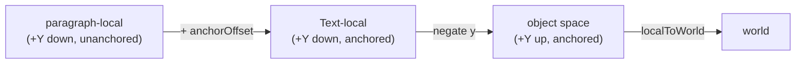

A number from Glyph is always in one of three spaces. Two of them have +Y pointing down, like a page; the third follows
the renderer. Knowing which API answers in which space, and that the anchor is the only difference between the first
two, removes most positioning mistakes.

## The three spaces

| Space                  | Origin                                   | +Y   | Anchor   | Used by                                                                                 |
| ---------------------- | ---------------------------------------- | ---- | -------- | --------------------------------------------------------------------------------------- |
| Paragraph-local        | Top-left corner of the paragraph box     | down | excluded | `measure()`, `glyphs()`, `readGlyphs()`, lines, `inkBounds`, `TextFlow` regions         |
| Text-local (logical)   | The text's own origin                    | down | included | `caret()`, `hitTest()`, `move()` goal positions, `rangeRects()`                         |
| Object space (three)   | The text's own origin                    | up   | included | `boundingBox`, `computeBoundingBox()`, `measureGlyphs()`, `split()`                     |

All three share +X to the right and the same unit. The text's own origin is the point its `position` (or the
integration's equivalent) places.

### Paragraph-local

The engine lays a paragraph out in a box whose top-left corner is `(0, 0)`. Lines stack downward, so a baseline has
a positive `y` and the second line's `y` is larger than the first's. Everything the engine measures is reported
here: `width`, `height`, `firstBaseline`, each line's `baseline`, each glyph's `x` and `y`, ink bounds.

This space does not know where the text is in your scene, and it does not move when you change the anchor. That is
deliberate: measurements and glyph columns stay comparable across texts however each one is placed.

### Text-local, logical

Editing works in Text-local coordinates: still +Y down, but measured from the text's origin with the anchor applied.
The caret rectangle from `caret()`, the point you pass to `hitTest()` and the rectangles from `rangeRects()` are all
in this space, so a caret and a selection drawn from them line up with the glyphs wherever the anchor puts them.

### Object space

The three.js integration draws in ordinary three.js object space: +Y up, origin at the `Text` object, anchor
included. `text.boundingBox`, `measureGlyphs()` and the objects `split()` returns are in this space, before the
object's own transform and its ancestors' transforms. From here on a `Text` is an `Object3D` like any other:
`localToWorld`, `worldToLocal`, parent groups and cameras apply as usual.

PixiJS 3D text is a `Container3D` and also draws +Y up. TypeGPU text has no scene graph: a text has a 2D `position`
in a top-left, +Y down space, and the `transformPosition` callback of its config maps that to clip coordinates.

## What the anchor does

`constraints.anchor` chooses which point of the paragraph box sits on the text's origin. With no anchor that point is
the top-left corner, so the paragraph extends to the right and, in three.js, downward along −Y. With
`{ x: 'center', y: 'middle' }` the box is centered on the origin. Vertical tokens can also name a typographic
reference such as `'first-baseline'`.

The anchor changes placement only. It does not change shaping, line breaks or any paragraph-local value. Its effect
is reported as one translation, `measure().anchorOffset`: the vector that moves paragraph-local coordinates so that
the anchor lands on the origin. For a centered anchor it is `(-width / 2, -height / 2)`.

Alignment is a different thing. `layout.align` positions lines inside the paragraph box; the anchor positions the
box. See [Anchor text](/guides/layout/anchor-text).

## Converting between spaces

The conversions are a translation and a sign flip.



From paragraph-local to object space, for example to place a marker on the first baseline:

```ts
import { Vector3 } from 'three/webgpu';

const layout = text.measure(); // paragraph-local
const logicalY = layout.firstBaseline + layout.anchorOffset.y; // Text-local, +Y down
const marker = new Vector3(layout.anchorOffset.x, -logicalY, 0); // object space, +Y up
text.localToWorld(marker); // world
```

From a world point to a caret, for example for a pointer hit:

```ts
import { Vector3 } from 'three/webgpu';

declare const worldPoint: Vector3; // where a ray met the text's plane

const local = text.worldToLocal(worldPoint.clone()); // object space, +Y up
const position = text.hitTest({ x: local.x, y: -local.y }); // Text-local, +Y down
const { rect } = text.caret(position); // Text-local, +Y down
const caretTop = text.localToWorld(new Vector3(rect.x, -rect.y, 0)); // world
```

A box converts the same way, with one detail: a box in a +Y down space is described by its top-left corner, so its
top edge in object space is `-y` and its bottom edge is `-(y + height)`.

## Units

Layout has one unit, and it is whatever your scene uses. `fontSize: 0.4` under a perspective camera is 0.4 world
units tall before the object's scale. Widths in `constraints`, `letterSpacing`, `outline.width`, `shadow.offset` and
flow regions are in that same unit.

With an orthographic camera set up so that one world unit is one pixel, `fontSize: 16` is 16 pixels, and every
measurement reads as pixels. Nothing in the package switches modes; the camera decides what a unit means on screen.

Scaling a `Text` object scales the drawn result without preparing the text again. Changing `fontSize` is a layout
change. Prefer `fontSize` when the size is a property of the text, and object scale when it is a property of the
scene, such as an animation.

### `rasterPixelRatio`

A bitmap font holds coverage at fixed pixel sizes, called strikes. The integration cannot know how many screen pixels
one layout unit covers, so it picks the strike nearest to `fontSize × rasterPixelRatio`. `rasterPixelRatio`
defaults to `1`: correct when one unit is one CSS pixel on a 1× display. Set it to the device pixel ratio, or to
pixels-per-unit under a camera that is not one-to-one, so the strike matches the pixels actually covered. It selects
raster data only; `fontSize` and every measurement keep their values.
[Pixel-perfect bitmap text](/guides/fonts/pixel-perfect-bitmap) shows the full setup.

## Spaces inside a custom material

A material created with `defineTextMaterial` receives two position nodes. `paragraphPosition` is the unanchored
paragraph-local position with +Y up: the space of `glyphs().inkBounds` with its Y axis negated. Use it for effects
that should follow the paragraph regardless of where the text is. `position` is the final draw-local position that the
default material assigns to `positionNode`; its value depends on the config's transform mode and is not comparable
with paragraph or Text-local bounds. See [Custom materials](/guides/scene/custom-materials).

## See also

- [Anchor text](/guides/layout/anchor-text)
- [Place text in 3D](/guides/scene/place-text-in-3d)
- [Caret and selection](/guides/editing/caret-and-selection)
- [Measurement reference](/reference/measurement)
- [Constraints reference](/reference/constraints)
