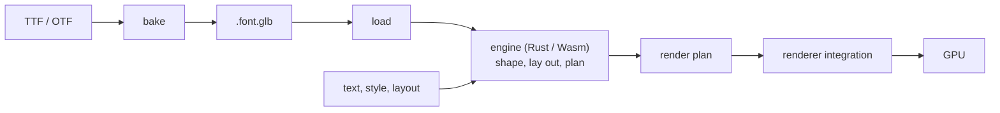

<link rel="stylesheet" href="/docs/assets/explainer.css" />

<glyph-explainer-root id="scenes" data-explainer-page="fonts" posters="/examples/thumbnails/" max-slots="2" max-dpr="1.5" opaque />

Glyph is a pipeline with five stages: bake a font, load it, shape and lay out text, describe the result as a render
plan, and let a renderer integration draw that plan. This page follows one paragraph through all five and says which
side of the WebAssembly boundary each stage runs on.

## The parts and who owns them

| Stage                         | Runs in                              | Owns                                                                                              |
| ----------------------------- | ------------------------------------ | ------------------------------------------------------------------------------------------------- |
| Bake                          | Node, or a browser Worker            | Turning a source font into shaping data and one or more rasters                                   |
| Load                          | TypeScript                           | Reading the `.font.glb`, registering shaping data with the engine, decoding the selected raster   |
| Validation and desired state  | TypeScript                           | Checking what you assign, recording it, marking the text dirty                                    |
| Shaping and paragraph layout  | Rust, compiled to WebAssembly        | Unicode analysis, bidirectional ordering, font fallback, shaping, line breaking, positioning      |
| Render plan                   | Rust, compiled to WebAssembly        | Packing instance records, tracking what changed, ordering draws                                   |
| Renderer integration          | TypeScript (`/three`, `/typegpu`, …) | Turning the plan into buffers, materials and draw objects the host renderer submits               |

TypeScript does not shape, break lines or pack instance data. It validates input, resolves fonts, and hands the
engine's output to the renderer.

## Bake

A source font is not drawn directly. Baking produces a `.font.glb`: a glTF binary that carries the font's shaping
tables and metrics in a `PMNDRS_font` extension, plus one or more **rasters**. A raster is the per-glyph data one
drawing technique needs: coverage bitmaps at fixed sizes (`bitmap`), a multi-channel distance field atlas (`msdf`), or
quadratic outlines arranged for analytic coverage (`slug`). Rasters can be embedded in the same file or written as
separate files next to it.

Baking normally happens ahead of time, in Node. The same bake code also runs in a browser Worker, so a `FontFace`
declared from a `.ttf` or `.otf` still works; it pays for the bake when it loads.
[Bake fonts](/guides/fonts/bake-fonts) and [Runtime baking](/guides/fonts/runtime-baking) cover both routes, and
[Formats](/explanation/formats) explains how the three rasters differ.

## Load

`glyph.fontFace(source, { format })` declares a font and the raster formats you intend to draw it with. Declaring
loads nothing. `load()` fetches the file, checks the GLB envelope and the extension version, registers the shaping data
with the engine, and decodes the rasters you selected. The result is an immutable `Font` per format. Every handle and
every text that uses the same declaration shares that one loaded font.

Shaping data and raster data stay separate from here on. The engine measures and positions glyphs from the shaping
data alone; a raster never takes part in measurement. That is why the same paragraph has the same layout in every
format.

## Shape and lay out

`glyph.init()` instantiates one WebAssembly engine for the page. A handle, created with `glyph.handle(name, config)`,
gives one renderer integration its own state inside that engine. Text objects created from the handle hold **desired
state**: the string, spans, style, paragraph layout, constraints and flow you assigned.

When a text is prepared, the engine analyzes the string (scripts, bidirectional levels, grapheme boundaries and
line-break opportunities), chooses a font for each cluster from the font stack, and shapes each run with HarfRust,
applying the font's substitution and positioning tables. It then breaks lines against the constraints and any flow
regions, aligns them, applies truncation, and positions every glyph in paragraph-local coordinates.

The engine retains the result, so later changes start from it. A text change reaches the engine as one range
replacement, whether you called `replace()` or assigned a whole new string: the setter finds the smallest range that
differs. A change that only moves lines, such as a new width, does not send the text again.

<glyph-proxy fit="cover" root="scenes" data-scene="shaping" aria-label="Eight scripts arriving one grapheme cluster at a time" aspect="4 / 3" />

Each row adds one grapheme cluster at a time. Watch a whole word change shape when a new cluster arrives: shaping
depends on neighbors, so the engine shapes runs, not characters.

## The render plan

Layout answers where glyphs are. The **render plan** answers what a renderer has to do about it. For each root the
engine keeps packed instance records (one per drawable glyph or decoration), the buffers that hold them, and an
ordered list of draws. When something changes it publishes the difference: which byte ranges of which buffers to
rewrite, which resources to acquire or release, and, when the set of draws changed, the new draw list.

The layout of an instance record is not fixed by the engine. Each integration installs a **codec** when its handle
is created: a small program that says which values go into which buffer lanes for each raster format. The engine runs
it while packing, so the bytes that arrive are already in the shape the integration's shaders read.
[The render plan](/explanation/render-plan) describes what is published and what stays retained.

## The renderer integration

An integration receives the plan as typed objects, stages the changes, and commits them. The three.js integration
keeps instanced meshes under a private object in your scene; three.js then draws them like any other mesh. The
TypeGPU integration records draws into a render pass you own. Glyph creates no canvas, device or render loop.
[Renderer integration](/explanation/renderer-integration) explains the contract an integration implements.

## What crosses the Wasm boundary

Calls into WebAssembly are the expensive, countable events in this design, so the API is arranged to make few of
them.

| You do                                                         | Calls into the engine                                                   |
| -------------------------------------------------------------- | ----------------------------------------------------------------------- |
| Assign `text`, `style`, `layout`, `constraints`, `flow`, spans | None. The value is validated and recorded in TypeScript.                |
| Read one text (`measure()`, `glyphs()`, an editing method)     | One preparation for that text if it is dirty, then the read.            |
| `glyph.prepare()`                                              | One call that prepares every dirty text of every handle.                |
| Render a frame with dirty texts                                | One call to prepare what is still dirty, one call to publish.           |
| Render a frame with nothing dirty                              | None.                                                                   |
| Move, rotate, scale, show or hide a text                       | None. Transforms are synchronized by the integration.                   |

Going in, a call carries the changed text as UTF-16 and the changed style, layout and geometry values. Coming out,
measurements are small fixed-size summaries, and the render plan is read in place from the engine's memory. That
memory is only lent: a plan is valid during the synchronous call that publishes it, and an integration copies what it
keeps into its own buffers before the call returns.

[When layout runs](/explanation/when-layout-runs) covers the timing of these calls in detail.

## See also

- [When layout runs](/explanation/when-layout-runs)
- [The render plan](/explanation/render-plan)
- [Formats](/explanation/formats)
- [Performance](/explanation/performance)
- [`glyph`](/reference/glyph)
