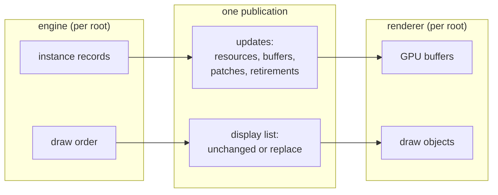

The engine does not hand a renderer a list of glyphs each frame. It keeps a retained description of what each root
draws and, when that description changes, publishes the difference. This page describes that publication, called the
render plan, as a renderer integration sees it. Application code never touches it; it matters if you want to
understand what an edit costs, or if you are [writing an integration](/explanation/renderer-integration).

## A retained model

Both sides hold state between frames.

- The **engine** holds, per root, the packed instance records of every drawable glyph and decoration, the layout of
  the buffers they live in, and the ordered list of draws.
- The **renderer** holds the realized counterparts: GPU buffers with the same bytes, resources such as atlas
  textures, materials or pipelines, and draw objects.

A publication moves the renderer's state to match the engine's. A root with nothing dirty publishes nothing, and the
renderer draws its retained state again. Moving, rotating, scaling or hiding a text is not a plan change at all: the
integration synchronizes transforms on a separate, cheaper path.



## What a publication contains

A renderer receives a `CommandBufferView`. It has two parts: `updates`, which change stored data, and `displayList`,
which says what to draw from that data.

### Updates

| Sequence      | Entries                                                           | Meaning                                                                                            |
| ------------- | ----------------------------------------------------------------- | -------------------------------------------------------------------------------------------------- |
| `resources`   | `acquire`, `update`, `retain`                                     | Font resources (an atlas, a Slug page, supplied geometry) the draws of this publication use.       |
| `buffers`     | `ensure`                                                          | An instance buffer must exist with this scalar type, vector width and capacity.                    |
| `patches`     | `allocate-or-resize`, `write`, `fill`, `copy`, `retire`           | Byte-range edits to those buffers. A `write` carries its payload; a `copy` moves bytes in place.   |
| `retirements` | `resource`, `buffer`, `slot-range`, `output-bytes`                | Things the renderer may release once this publication is accepted.                                 |

Patches are what make an update proportional to the change. A patch covers a dirty byte range of one buffer, and
the engine coalesces ranges that are close together into one write. Because each raster format spreads an instance
over several buffers (placement in one, color in another), how much is rewritten depends on what the edit touched
and on how many records it moved.

### The display list

`displayList` is either `{ kind: 'unchanged' }` or `{ kind: 'replace', value }`. When it is unchanged, the set and
order of draws is the one the renderer already holds: it applies the patches and keeps every draw object it has.

A replacement carries the complete ordered list for the root:

- `transforms`: the transform bindings the root's draws refer to.
- `children`: the draws, in the order they must be drawn. Each child is a **batch**, which draws one or more spans of
  instance records, or a root **instance**, which draws one span with its own transform.

Each span names a kind (`glyph`, `decoration`, `inline-object`, `clip` or `codec`), the index of its first record,
and its record count. The order of `children` is authoritative: decorations under glyphs, glyphs, decorations over
glyphs, with paragraph order and render order already resolved. A renderer draws the list as given and does not sort
it.

### Checkpoints and revisions

Most publications are incremental: they assume the renderer holds the previous one. `checkpoint: true` marks a
publication that is complete in itself and replaces everything the renderer holds for the root, for example the
one that follows an engine recovery. `revision` increases with each publication of a root.

## Typed bindings, not numeric ids

Inside the engine, programs, buffers, resources and materials are numbers. A renderer never sees them. Before the
view reaches `decode`, Glyph projects it through the integration's **schema**: a set of callbacks that turn each
engine identity into an object the renderer chose, once, and reuse it afterwards. A patch therefore refers to "this
buffer object", and a batch refers to "this program object, these buffer objects, this material".

This is also where an integration can keep its draw objects stable. A schema that declares
`preservesHostTopology` promises that its batch and instance bindings do not depend on values that change without
changing what is bound. A replacement display list that keeps the same storage, order and bindings is then marked
`retainedTopology`, and the renderer updates counts and bounds on its existing draw objects without rebuilding them.

## How draws form

One draw can cover many texts. The engine merges adjacent spans into one draw while they agree on everything a draw
binds: the technique and program, the font resource, the material, the depth key and the order, and, in a
config that uses direct transforms, the transform. A span that differs in any of these starts a new draw.

"Adjacent" matters. Batching follows draw order, so two labels with the same material separated by one with a
different material are three draws, not two. [Performance](/explanation/performance) discusses what this means for
how you group text, and `TextGroup.batching` controls where the boundaries fall in three.js.

## The view is borrowed

The view and everything reachable from it, including patch payloads, point into engine memory that the next engine
call may overwrite. They are valid only during the synchronous `decode` call. A renderer reads what it needs, copies
what it keeps, and returns.

`decode` does not apply anything. It stages candidate state and returns a transaction with `commit()` and
`discard()`. `commit()` swaps the staged state in once all staging that can fail has succeeded; `discard()` releases
the candidate. A rejected publication therefore leaves the previously accepted draws on screen.

```ts
import type { CommandBufferView, GlyphBindingSet, GlyphRenderer, PreparedRendererCommit } from '@pmndrs/glyph';

interface Staged {
  readonly writes: readonly { readonly buffer: object; readonly offset: number; readonly bytes: Uint8Array }[];
  readonly draws: number;
}

export function createRenderer<Bindings extends GlyphBindingSet>(): GlyphRenderer<Bindings, Staged> {
  let committed: Staged = { writes: [], draws: 0 };
  return {
    decode(view: CommandBufferView<Bindings>): PreparedRendererCommit<Staged> {
      // Copy every payload now: the view expires when this call returns.
      const writes = Array.from(view.updates.patches).flatMap((patch) =>
        patch.kind === 'write'
          ? [{ buffer: patch.buffer, offset: patch.destinationOffset, bytes: patch.payload.slice() }]
          : [],
      );
      const draws = view.displayList.kind === 'replace' ? view.displayList.value.children.length : committed.draws;
      const staged: Staged = { writes, draws };
      return {
        result: staged,
        commit: () => {
          committed = staged; // the only place accepted state changes
        },
        discard: () => undefined,
      };
    },
    syncTransforms: () => undefined,
    dispose: () => undefined,
  };
}
```

## What this buys

- A frame in which nothing changed costs no engine call and no upload.
- A frame in which text changed uploads the bytes that changed.
- A frame in which only transforms changed never enters the engine.
- A failure while staging one root does not corrupt what the renderer already draws.

## See also

- [Renderer integration](/explanation/renderer-integration)
- [How it works](/explanation/how-it-works)
- [Performance](/explanation/performance)
- [`@pmndrs/glyph/core` reference](/reference/core)
