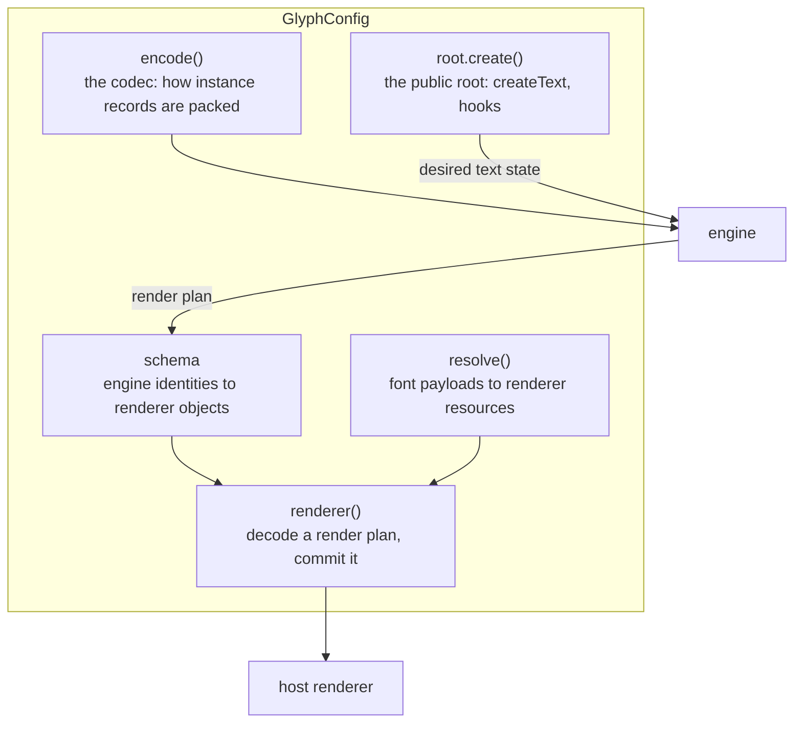
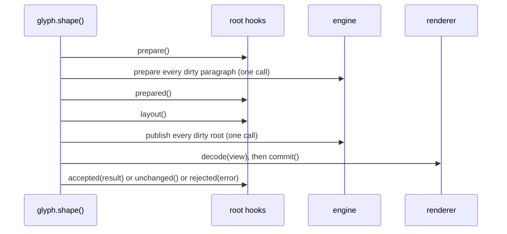

The three.js, TypeGPU and PixiJS 3D entry points are not special. Each is a `GlyphConfig` built from the public
contract in `@pmndrs/glyph/core`, and a renderer the package does not ship can be integrated the same way. This page
explains the parts of that contract and how they fit together. It is a map, not a walkthrough: the built-in
integrations and the `packages/glyph-example-renderer` package in the repository are the worked examples.

## What an integration is responsible for

The engine owns text: shaping, layout, instance packing, draw order. The host renderer owns pixels: the canvas, the
device, passes and submission. An integration sits between them and supplies four things.



| Field      | Required | Role                                                                                              |
| ---------- | -------- | ------------------------------------------------------------------------------------------------- |
| `schema`   | yes      | Turns each engine identity (program, buffer, material, transform, draw) into a renderer object.   |
| `encode`   | yes      | Returns the codec: which values the engine packs into which buffer lanes, per raster format.      |
| `resolve`  | yes      | Turns a font's portable payload (an atlas, a table, geometry) into a leased renderer resource.    |
| `renderer` | yes      | Creates the per-root object that decodes a render plan into staged state and commits it.          |
| `root`     | yes      | Builds the root object applications use, on top of services the handle provides.                  |
| `fonts`    | no       | The raster formats this handle accepts, keyed by name, and which key is the default.              |
| `commands` | no       | Initial capacities and fixed limits for a root's publications, including `maxTextUnits`.          |

`defineGlyphConfig(config)` returns its argument; its purpose is inference. It ties the schema's binding types, the
renderer's result type, the boundary type, the root type and the font formats together so that
`glyph.handle(name, config)` returns a handle typed as your root.

## The codec

The engine does not know what your shader reads. The codec tells it. For each raster format the handle supports,
`encode()` contributes one **program**: a short straight-line recipe, run once per glyph inside the engine, that
computes values (origin, size, color, a glyph-table index) and stores them into named buffer lanes.

The portable half of a program belongs to the raster format, not to the renderer. `bitmapCodec`, `msdfCodec` and
`slugCodec` are the built-in ones. An integration adds what is specific to itself with
`createRasterCodecProgram(codec, options)`:

- a **capability set**: limits such as the largest buffer and the number of buffers one draw may bind;
- **system buffers** the integration wants in addition to the format's own: a stable glyph id, a placement slot,
  and optionally a transform index;
- a **transform mode**: `'direct'` leaves each text's transform to the draw, so texts with different transforms
  cannot share a draw; `'indexed'` adds a transform index per record so that they can.

Changing record layout, batching or ordering is a codec decision. There is no hook for reinterpreting packed data
after the engine has produced it.

## The schema

A render plan refers to programs, buffers and materials. The schema is where those references become your objects.
It has seven callbacks, and each receives the root's **boundary** first: a value of your choosing that identifies
where this root publishes (three.js uses an `Object3D`; a renderer without a scene graph can use a small record).

| Callback       | Called with                                              | Returns                                   |
| -------------- | -------------------------------------------------------- | ----------------------------------------- |
| `program`      | A `CodecProgram`                                         | Your pipeline or shader selector          |
| `buffer`       | The buffer's declaration and its program                 | Your buffer binding                       |
| `material`     | The material value a text was given                      | Your material or paint binding            |
| `transform`    | The transform value a text was given, and its table row  | Your transform binding                    |
| `batch`        | A draw covering several spans                            | Your batched draw object                  |
| `instance`     | A draw covering one span with its own transform          | Your instance draw object                 |
| `instanceSpan` | One contiguous run of records                            | Your span binding                         |

`defineGlyphSchema(schema)` checks and freezes the table and infers the whole binding vocabulary from the
callbacks' return types. What `material` and `transform` accept is up to you: those types become the
`material` and `transform` fields of the text state your root passes to the engine.

## Resolve and resource leases

When a draw first needs a font resource, `resolve(context)` receives the format id, the resource's name and kind in
the format's schema, the portable payload, any companion payloads of the same font, the previously accepted
resource, and an abort signal. It returns a `ResourceLease`: a value plus a `dispose()` that Glyph calls exactly
once when nothing uses the resource any more. `resourceLease(value, release)` builds one.

Resolution does not have to touch the GPU. The three.js config keeps the payload and lets three's own managers create
textures when a renderer first draws them. An integration that has a device at hand can upload in `resolve` instead.

## The renderer

`renderer(context)` is called once per root and returns a `GlyphRenderer`.

- `decode(view)` receives a render plan as a `CommandBufferView` and returns `{ result, commit(), discard() }`. It
  stages; `commit()` applies. The view is borrowed and must not be kept. [The render plan](/explanation/render-plan)
  describes its contents.
- `syncTransforms(updates)` is the path for transform-only changes, which never produce a render plan.
- `dispose()` releases what the renderer holds for the root.

`result` is whatever your root wants to receive when a publication is accepted: a draw list, a count, nothing.

## The root recipe and its services

`root.create(context)` builds the object an application holds. The context gives it the root's name, the selected
codec, font access for the handle's formats, and `services`: the constrained interface to the engine for this root.
The recipe calls `context.create(extension, options)` to finish. `extension` is your public API (`createText`, a
`draw` method, anything); Glyph adds `name`, `handle`, `disposed` and `dispose()`.

The services that matter most:

| Service                              | Purpose                                                                                   |
| ------------------------------------ | ----------------------------------------------------------------------------------------- |
| `createText(state)`                  | Registers a paragraph and returns its `GlyphTextController`.                              |
| `assertTextUnits(text)`              | Throws if a string exceeds the root's `maxTextUnits`, so a setter can refuse it itself.   |
| `invalidate()`                       | Marks the root as needing the next `glyph.shape()`.                                       |
| `syncTransforms(updates?)`           | Synchronizes retained transforms without a publication.                                   |
| `copy(text, request, destination)`   | Copies part of a prepared text into an independent renderer, as `Text.split()` does.      |

### Shape hooks

`options.shape` lets the root take part in each `glyph.shape()` and `glyph.prepare()`. All hooks are optional.



| Hook            | When it runs                                                                                         |
| --------------- | ---------------------------------------------------------------------------------------------------- |
| `prepare()`     | First. Reconcile retained host state. Returning `false` defers the root until its next invalidation. |
| `prepared()`    | After every dirty paragraph of the root is prepared, before anything is published. Resolve anchors and read measurements here. |
| `layout()`      | After every dirty root is prepared. Run the texts' layout callbacks here; contain each one's exception. While these hooks run, `controller.update()` throws `GlyphLayoutPhaseError` for a change to a layout input. |
| `accepted()`    | After the renderer committed this root and the borrowed view expired. Receives the renderer's `result`. |
| `unchanged()`   | Instead of `accepted()`, when the renderer already draws the root's desired state.                   |
| `rejected()`    | When the root failed. Its last accepted renderer state is unchanged.                                 |
| `invalidated()` | When a setter leaves the root needing a frame. A host with an on-demand loop requests one here.      |

## The text controller

`services.createText(state)` returns a `GlyphTextController`. Your public text class holds it privately and
translates its own setters into complete state snapshots.

- `update(state)` records a new desired state. It validates and marks dirty; it does not enter the engine and does
  not throw engine errors.
- `measure()`, `measureInk()`, `inspect()` and `readGlyphs(read)` are the reads. Each prepares the paragraph first
  when it is dirty.
- `editing` holds `caret`, `hitTest`, `move`, `boundary`, `rangeRects` and `beginReplace(start, end, insert)`.
  `beginReplace` validates a replacement and states it to the engine before your class sets the new string.
- `keepMeasured` asks every batch preparation to return this text's summary; set it for a text that has a layout
  callback. `preparedMeasurement()` then reads that summary without entering the engine.
- `refusal` is the error that refused this text's last preparation, or `undefined`.
- `awaitsPreparation` is `true` for a text left for a later preparation; do not read it or count it as published.
- `updateParagraphOrder(order, scope, rank)` changes draw order without invalidating shaping or layout.
- `dispose()` removes the paragraph.

The state passed to `createText` and `update` is always complete: `font`, `text` (a string, or text with spans),
`transform`, and optionally `material`, `order`, `rasterPixelRatio`, `style`, `layout`, `constraints` and `flow`.
Partial updates and inheritance are your class's business.

## A complete, minimal config

This config integrates a renderer that only counts draws. It supports the built-in MSDF format by reusing
`msdfCodec`, so it needs no shader and no baker of its own.

```ts
import { glyph, msdf } from '@pmndrs/glyph';
import type { CodecCapabilitySet, FontFaceSelection } from '@pmndrs/glyph';
import {
  createRasterCodecProgram,
  defineCodecBuffers,
  defineGlyphConfig,
  defineGlyphSchema,
  id,
  msdfCodec,
  resourceLease,
} from '@pmndrs/glyph/core';

// What this renderer can bind, and the system buffers it wants beside the format's own.
const capabilitySet: CodecCapabilitySet = {
  capabilities: ['storage-buffers', 'alias-vec2', 'alias-vec4', 'ordered-direct'],
  maxBufferBytes: 16 * 1024 * 1024,
  updateAlignment: 4,
  coalesceGapBytes: 128,
  rangeCallPenaltyBytes: 256,
  maxBuffersPerDraw: 8,
  maxResourcesPerDraw: 4,
  maxIndirectDraws: 0,
  fragmentationBudget: 8,
  wholeBufferThresholdBasisPoints: 7_500,
};
const system = defineCodecBuffers({
  stableGlyphId: { id: id.buffer('counter/stable-glyph'), scalar: 'u32', lanes: ['stableGlyphId'] },
  placementSlot: { id: id.buffer('counter/placement-slot'), scalar: 'u32', lanes: ['placementSlot'] },
});

interface Boundary {
  readonly name: string | undefined;
}
interface Transform {
  readonly x: number;
  readonly y: number;
}

// Engine identities become these objects once and are reused in every later publication.
const schema = defineGlyphSchema({
  program: (_boundary: Boundary, program) => ({ kind: 'program' as const, program }),
  buffer: (_boundary, input) => ({ kind: 'buffer' as const, input }),
  material: (_boundary, material: { readonly tint: string }) => material,
  transform: (_boundary, transform: Transform) => transform,
  batch: (_boundary, input) => ({ kind: 'batch' as const, order: input.order }),
  instance: (_boundary, input) => ({ kind: 'instance' as const, order: input.order }),
  instanceSpan: (_boundary, input) => ({ first: input.recordIndex, count: input.recordCount }),
});

export const CounterConfig = defineGlyphConfig({
  schema,
  fonts: { default: 'msdf', formats: { msdf } },
  encode: ({ ids }) => ({
    descriptor: {
      capabilitySets: [capabilitySet],
      programs: [
        createRasterCodecProgram(msdfCodec, {
          namespace: 'counter',
          system,
          capabilitySet,
          transformMode: 'direct',
          ids,
        }),
      ],
    },
  }),
  resolve: ({ resourceName, payload }) => resourceLease({ resourceName, payload }, () => undefined),
  renderer: () => {
    let draws = 0;
    return {
      decode(view) {
        const next = view.displayList.kind === 'replace' ? view.displayList.value.children.length : draws;
        return {
          result: next,
          commit: () => {
            draws = next;
          },
          discard: () => undefined,
        };
      },
      syncTransforms: () => undefined,
      dispose: () => undefined,
    };
  },
  root: {
    create(context) {
      const { fonts, services } = context;
      if (fonts === undefined) throw new TypeError('CounterConfig must declare font formats');
      let draws = 0;
      const extension = {
        get draws(): number {
          return draws;
        },
        createLabel(selection: FontFaceSelection<typeof msdf>, text: string) {
          const font = fonts.acquire(selection); // a lease this label owns
          const controller = services.createText({
            font,
            text,
            transform: { x: 0, y: 0 },
            style: { fontSize: 16 },
          });
          return {
            measure: () => controller.measure(),
            dispose(): void {
              controller.dispose();
              font.dispose();
            },
          };
        },
      };
      return context.create(extension, {
        boundary: { name: context.name },
        shape: {
          accepted: (result) => {
            draws = result;
          },
        },
      });
    },
  },
});

await glyph.init();
const counter = glyph.handle('counter', CounterConfig);
const face = glyph.fontFace(url, { format: msdf });
await face.load();

const label = counter.createLabel(face.msdf, 'Hello');
label.measure().width; // prepares the paragraph
glyph.shape(); // publishes; decode, commit, then accepted(result)
counter.draws;
```

A real integration replaces the counting renderer with one that applies buffer updates and patches to GPU buffers,
builds draw objects from the display list, and binds shaders that read the lanes the codec wrote.

## Where to look next

- `packages/glyph-example-renderer` is a complete third-party integration built only from public exports: a
  recording device for tests and a TypeGPU device that draws.
- The three.js integration (`packages/glyph/src/three/`) is the fullest example. Its config is assembled in
  `three/internal/define-config.ts`; it uses every shape hook.
- `@pmndrs/glyph/shaders/tsl` and `@pmndrs/glyph/shaders/typegpu` export the built-in formats' shader math so that an
  integration does not reimplement coverage. See the [shaders reference](/reference/shaders).
- To add a raster format instead of a renderer, see [Add a custom format](/guides/project/custom-format).

## See also

- [`@pmndrs/glyph/core` reference](/reference/core)
- [The render plan](/explanation/render-plan)
- [Shaders reference](/reference/shaders)
- [Add a custom format](/guides/project/custom-format)
- [When layout runs](/explanation/when-layout-runs)
