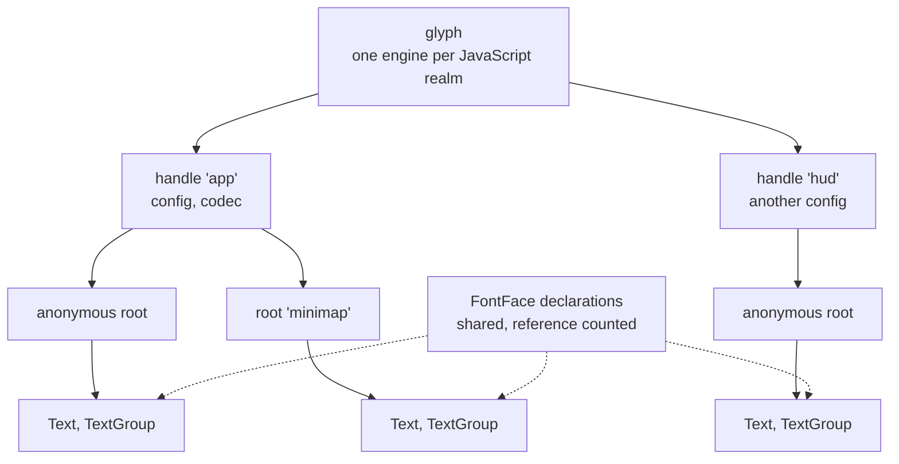

Most applications need one handle and never think about roots. The structure underneath matters when you have a
second scene, a HUD with different needs, several canvases, or a worker. This page explains the ownership model and
the reasons to split.

## The ownership tree



**The engine.** `glyph.init()` creates one WebAssembly engine for the current realm; repeated calls share the same
promise. Every handle lives in it, and `glyph.shape()` and `glyph.prepare()` act on all of them in one call.

**A handle** is one renderer integration's state: `glyph.handle(name, config)`. The config fixes the handle's
policies for its whole life: with three.js those are the capacity policy, the transform mode, the MSDF atlas mode,
the default font format and `maxTextUnits`. A handle's name must be unique among live handles; disposing a handle
frees its name.

**A root** is a unit of publication. It has its own render plan, its own instance buffers and its own draws. Every
handle is itself its anonymous root, so `handle.createText(...)` works directly. Calling the handle with a name,
`handle('minimap')`, returns a named root; the same name always returns the same root while it lives. Named roots
are siblings: a root cannot create further roots.

**Text and groups** belong to the root that created them. A `TextGroup` organizes scene hierarchy, inheritance and
batching inside a root. It is not a root and does not publish separately.

**Fonts** sit beside this tree, not inside it. A `FontFace` declaration and its loaded data are shared by every
handle and root in the realm. Each text takes its own lease on the font it uses, and the data is released when the
declaration is disposed and no text uses it.

## Names

Handle names and root names are labels you choose. A handle name identifies the handle in errors and must be
unique. A root name selects a root and appears in the name of the root's private scene object
(`@pmndrs/glyph:<name>`), which is useful when inspecting a scene. Neither is tied to a scene's or a canvas's
identity.

```ts
import { glyph } from '@pmndrs/glyph';
import { ThreeConfig } from '@pmndrs/glyph/three';

await glyph.init();
const app = glyph.handle('app', ThreeConfig);

app.name; // undefined: the handle is its anonymous root
const minimap = app('minimap');
minimap.name; // 'minimap'
app('minimap') === minimap; // true while the root lives
minimap.handle === app; // true
```

## Reasons to add a root

**A second scene.** With three.js a root binds to at most one `Scene`, which it learns from the texts added to it. A
root whose texts are in two scenes throws from the traversal that discovers it. Text for a second scene, such as an
overlay scene rendered with its own camera, comes from a second root.

```ts
import { Scene } from 'three/webgpu';

const overlay = new Scene();
scene.add(handle.createText({ font: Inter.msdf, text: 'world' }));
overlay.add(handle('overlay').createText({ font: Inter.msdf, text: 'HP 100' }));
```

**A different rate of change.** A root takes part in a frame's publication only when one of its texts is dirty. Text
that changes every frame on its own root keeps a large static root out of that work.

**A lifetime.** `root.dispose()` disposes the root's texts and draws together. A panel that comes and goes can be
one root.

**Counting.** `textCount` and `gpuBytes` are reported per root, so a root is also a unit of measurement.

A root is not free: batching does not cross roots, and each root keeps its own instance buffers. Do not create one
per label. The roots of one handle share that handle's GPU atlases, and each root's `gpuBytes` includes them, so do
not add the figures of sibling roots together.

## Reasons to add a handle

A second handle is needed when the configuration must differ. Capacity cannot change on a live handle, so a HUD
with a hard memory budget and a document view that must grow are two handles:

```ts
import { glyph } from '@pmndrs/glyph';
import { defineThreeConfig } from '@pmndrs/glyph/three';

const hud = glyph.handle('hud', defineThreeConfig({ capacity: { size: 512, policy: 'fixed' } }));
const pages = glyph.handle('pages', defineThreeConfig({ capacity: { size: 16_384, policy: 'chunk' } }));

hud.createText({ font: Inter.msdf, text: 'HP 100' });
pages.createText({ font: Inter.msdf, text: 'Chapter one' }); // the same loaded font, no second load
```

A second handle is also how two integrations coexist: a three.js handle and a TypeGPU handle on one page are two
handles in the same engine, each with its own config.

## Several canvases

Glyph creates no canvas and no renderer, and a handle is not bound to one. Each three.js renderer has its own canvas
and is constructed as usual. The rule that applies is the scene rule: each scene that contains text needs its own
root. Two canvases showing two scenes are two roots of one handle; fonts are loaded once for both.

With React Three Fiber, text under a `<Canvas>` uses a default handle. To place a subtree on another root, wrap it
in `<GlyphProvider handle="name">` for a named root of the default handle, or pass a handle or root you created.
See [React Three Fiber](/guides/renderers/react-three-fiber).

## Workers

A worker is a separate realm with its own module instances, so it has its own engine: call `glyph.init()` there
and create handles there. Live fonts, texts and handles cannot be transferred. Font data can: `clone()` on a
`FontFace` or on one of its format selections produces a serializable snapshot and the list of buffers to transfer.
The source declaration stays valid.

```ts
import type { SerializedFontFace } from '@pmndrs/glyph';

declare const worker: Worker;

const [serialized, transfer] = await Inter.msdf.clone();
worker.postMessage(serialized satisfies SerializedFontFace, { transfer });
```

In the worker, the snapshot is a font source like a URL:

```ts
import { glyph, msdf, type SerializedFontFace } from '@pmndrs/glyph';

declare const message: MessageEvent<SerializedFontFace>;

await glyph.init();
const InterInWorker = glyph.fontFace(message.data, { family: 'Inter', format: msdf });
await InterInWorker.msdf.load(); // no fetch: the bytes arrived with the message
```

## Disposal

Disposal follows the tree downward. Disposing a handle disposes its roots, the paragraphs and renderer state they
hold and the handle's codec, and frees its name. Disposing a root does the same for that root. Neither touches a
`FontFace`: dispose a declaration yourself when nothing will use it again. A `TextGroup` is the exception to
"downward": disposing a group does not dispose the texts inside it.

A `Text` holds its own lease on its font and releases it in `text.dispose()`. The order that releases everything is
therefore texts first, then groups, then the root or handle, then the `FontFace`.

Host objects stay yours. Glyph never disposes a scene, a renderer, a device or a canvas.

## See also

- [Performance](/explanation/performance)
- [three.js renderer guide](/guides/renderers/three)
- [React Three Fiber](/guides/renderers/react-three-fiber)
- [`ThreeRoot` reference](/reference/three-root)
- [`glyph` reference](/reference/glyph)
