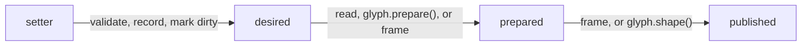
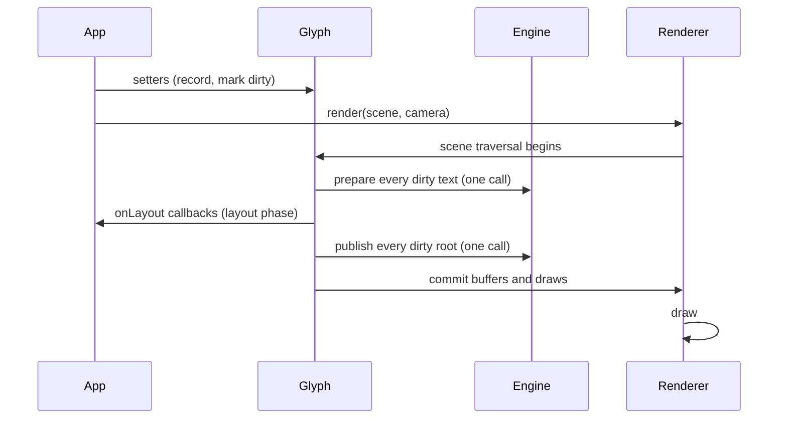

Assigning to a text does not lay it out. Layout runs when something needs the answer: a read, an explicit
`glyph.prepare()`, or the frame. This page explains that model, the three states a text moves through, and the
consequences for reads, callbacks and errors.

## Three states

A text has **desired** state (what you assigned), **prepared** state (the layout the engine computed for it) and
**published** state (what the renderer currently draws).



A setter validates its value, records it, and marks the text dirty. It makes no call into the engine. An invalid
value throws `GlyphInputError` from the setter and the text keeps its previous value. Creating a text is a setter in
this sense too.

Preparation shapes and lays out a dirty text. Publication hands the renderer the changed instance data and draws.
The two are separate so that reading a measurement never forces a draw, and so that a frame can prepare every dirty
text in one engine call.

## Reads prepare, and are never stale

Every read prepares its text first if a setter left it dirty: `measure()`, `glyphs()`, `readGlyphs()`,
`boundingBox`, the editing methods (`caret`, `hitTest`, `move`, `boundary`, `rangeRects`) and `split()`. A read
therefore always describes the value you last assigned. It never returns `undefined` because a frame has not run yet.

```ts
text.text = 'Score: 1200'; // recorded; no engine call
const { width } = text.measure(); // prepares this one text, then answers for 'Score: 1200'
```

A read prepares only the text it is called on, and it does not publish. The renderer keeps drawing the previous
published state until the next frame.

## `glyph.prepare()` and `glyph.shape()`

Both act on every dirty text of every handle.

- `glyph.prepare()` prepares them in one engine call and publishes nothing. It also keeps each text's measurement, so
  a `measure()` that follows does not enter the engine again.
- `glyph.shape()` prepares whatever is still dirty, then publishes every dirty root to its renderer.

A loop that reads many dirty texts costs one engine call per text. Calling `glyph.prepare()` first makes it one call
for all of them:

```ts
import { glyph, type msdf } from '@pmndrs/glyph';
import type { Text } from '@pmndrs/glyph/three';

declare const labels: readonly Text<typeof msdf>[];

for (const label of labels) label.style = { fontSize: 18 };
glyph.prepare(); // one engine call for every dirty label
const widest = Math.max(...labels.map((label) => label.measure().width));
```

With three.js, React Three Fiber and Vue you rarely call `glyph.shape()` yourself. A root keeps two private objects in
the Scene that holds its text. Three visits the first before any other object computes its matrix, and there the frame
prepares every dirty text and runs layout callbacks. When the traversal reaches the second, the frame prepares
whatever became dirty since and publishes. `renderer.render(scene, camera)` is therefore enough. A frame with nothing
dirty makes no engine call. TypeGPU and PixiJS 3D have no scene traversal to hook, so their applications call
`glyph.shape()` once per frame.

## The layout phase and `onLayout`

Sometimes a layout decides something else: a panel sized to its label, a caret placed after a line. Reading
`measure()` after a frame would be one frame late. `onLayout` exists for this.

```ts
import type { Mesh } from 'three/webgpu';

declare const panel: Mesh;

text.onLayout = (label, layout) => {
  panel.scale.set(layout.width + 24, layout.height + 16, 1);
};
```

The callback receives the text and the same summary `measure()` returns. It runs in the **layout phase**: after
every dirty text of every root is prepared, and before anything is published. What the callback writes is drawn by
the same frame, the first frame included.



Three rules follow from where the phase sits.

**It runs when the layout changed.** A callback runs after the text's first preparation and after any later one whose
summary differs: width, height, line count, glyph count or anchor offset. A color, opacity, material or transform
change does not run it. Neither does an on-demand read, because the caller of that read already has the answer.

**It may paint and place, but not re-lay out.** Inside a callback you may read any text and write transforms,
visibility, color, opacity and material. Writing a layout input of any text (`text`, `font`, the non-paint parts of
`style`, `layout`, `constraints`, `flow`, `rasterPixelRatio`, spans) throws `GlyphLayoutPhaseError` from that setter,
and the text keeps its value. A layout written there could not be prepared before the frame it was meant for, so the
write is refused where it is made.

**A text with a callback is drawn only at a layout its callback has seen.** If a layout input of such a text changes
after the frame's layout phase has already run, that text stays at its published state for this frame. The next frame
runs its callback and draws it. Text without a callback is always drawn by the frame that changed it.

## `commitState()`

`commitState()` reports where one three.js text stands, without preparing anything.

| Status      | Meaning                                                                                    |
| ----------- | ------------------------------------------------------------------------------------------ |
| `unbound`   | The text is disposed or has no parent in a scene graph.                                    |
| `pending`   | The current desired state is not what is drawn.                                            |
| `committed` | The renderer draws the current desired state. `revision` identifies that published state. |

`pending` covers several situations: a setter ran and no frame has followed, the text is held for its layout
callback, a `fixed` capacity cannot fit it, or the engine refused it. It does not mean "laid out but not drawn",
and it says nothing about whether a read would succeed: reads prepare on their own.

```ts
const state = text.commitState();
if (state.status === 'committed') console.info('drawn at revision', state.revision);
```

## Why render-time failures throw from the render

Because setters make no engine call, a setter can only report what it can check itself: the shape and range of
its input. Anything the engine or the renderer discovers later has no setter to throw from. Glyph has no error
callback for these. A failure found while rendering is thrown from that render:

- a paragraph the engine refused,
- a publication the renderer rejected,
- an engine restart,
- a `fixed` root capacity exceeded,
- an exception thrown by your own `onLayout` callback.

With three.js the throw comes from the end of `renderer.render(scene, camera)`, after three has drawn the frame. With
TypeGPU it comes from the root's next `draw()`, and with PixiJS 3D from `glyph.shape()`.

```ts
try {
  renderer.render(scene, camera);
} catch (error) {
  console.error(error); // for example: Glyph text "Hello, wor…" was not drawn: …
}
```

The behavior is designed so that one bad text cannot take a scene down:

- **The frame still happens.** The failed text draws nothing until its input changes. Its siblings draw.
- **A failure is thrown once.** A failure the next frame finds again is still standing and is not thrown again, so a
  render loop is not flooded. New input that fails is a new failure. Several failures in one render arrive as one
  `AggregateError`.
- **The message names the text.** It quotes the first 40 UTF-16 units of the failed text, and the underlying error
  is its `cause`. There is no per-text error property to poll.

The reasoning is that a callback would be a second error channel every application has to remember to wire, and an
unwired one hides the failure. A throw reaches whatever the application already has: a `try` around the render, an
error boundary, `window.onerror`, an error reporting service. three.js treats an exception from an `onBeforeRender`
callback the same way.

GPU-level errors follow the host renderer. Where three.js only logs (a shader that fails to compile, a lost device),
Glyph adds no throw of its own.

## See also

- [Handle errors](/guides/project/handle-errors)
- [React to layout](/guides/inspect/react-to-layout)
- [Measure text](/guides/inspect/measure-text)
- [Errors reference](/reference/errors)
- [How it works](/explanation/how-it-works)
